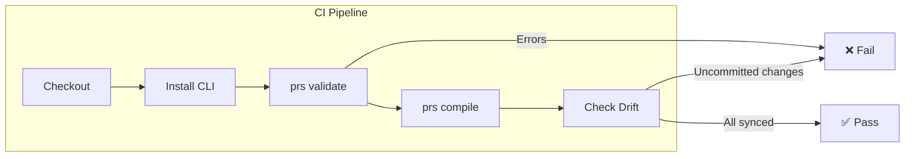

# CI/CD Integration

PromptScript creates prompt-as-code for your AI instructions. Like any code, it should be validated and tested in your Continuous Integration (CI) pipeline.

## Overview

Integrating PromptScript into CI/CD provides:

- **Syntax Validation** - Catch `.prs` file errors before merge
- **Drift Detection** - Ensure compiled outputs are up-to-date
- **Registry Sync** - Validate against latest registry standards
- **Change Tracking** - Only run on relevant file changes



## Key Commands for CI

| Command                             | Purpose                                       | Exit Code                                                                                        |
| ----------------------------------- | --------------------------------------------- | ------------------------------------------------------------------------------------------------ |
| `prs validate`                      | Validate syntax and structure                 | 0=pass, 1=error                                                                                  |
| `prs validate --strict`             | Treat warnings as errors                      | 0=pass, 1=error or warning                                                                       |
| `prs validate --format json`        | JSON report for parsing                       | Same as above                                                                                    |
| `prs compile`                       | Compile to all targets                        | 0=success, 1=error                                                                               |
| `prs compile --dry-run`             | Preview without writing                       | 0=success, 1=error                                                                               |
| `prs check`                         | Check config and dependencies                 | 0=healthy, 1=issues                                                                              |
| `prs diff --all`                    | Show uncommitted changes                      | 0=shown, 1=error                                                                                 |
| `prs diff --format json`            | Machine-readable diff report                  | 0=report produced, 1=error                                                                       |
| `prs release status --check-models` | Check the models of labelled prompts          | 0=ok, 1=`PS5011` or any other release error (a missing or corrupt bundle)                        |
| `prs eval run --label <env>`        | Run eval suites on what an environment serves | 0=passed, 1=failed, regression, budget or error, 2=warnings (with `--strict`)                    |
| `prs eval run`                      | Replay eval suites from the committed cache   | 0=passed, 1=failed, regression or error (a cache miss is `PS6402`), 2=warnings (with `--strict`) |
| `prs eval compare <a> <b>`          | Compare two eval reports offline              | 0=compared, 1=error, or regression with `--fail-on-regression`                                   |

## GitHub Actions

:::tip[Pin the CLI version]
Examples below install the latest CLI for simplicity. Pin an exact version in CI
(`npm install -g @promptscript/cli@1.19.0`) so validation and compiled output stay
reproducible, then upgrade the pin deliberately with a reviewed change.
:::

### Basic Validation

Create `.github/workflows/promptscript.yml`:

```yaml
name: PromptScript

on:
  push:
    branches: [main]
  pull_request:
    branches: [main]

jobs:
  validate:
    runs-on: ubuntu-latest
    steps:
      - uses: actions/checkout@v4

      - name: Setup Node.js
        uses: actions/setup-node@v4
        with:
          node-version: '22'

      - name: Install PromptScript CLI
        run: npm install -g @promptscript/cli

      - name: Validate PromptScript files
        run: prs validate --strict

      - name: Compile and verify
        run: prs compile
```

### Drift Detection

Ensure compiled files are always in sync with source `.prs` files:

```yaml
name: PromptScript Drift Detection

on:
  push:
    paths:
      - '.promptscript/**'
      - 'promptscript.yaml'
  pull_request:
    paths:
      - '.promptscript/**'
      - 'promptscript.yaml'

jobs:
  check-drift:
    runs-on: ubuntu-latest
    steps:
      - uses: actions/checkout@v4

      - uses: actions/setup-node@v4
        with:
          node-version: '22'

      - name: Install PromptScript CLI
        run: npm install -g @promptscript/cli

      - name: Validate
        run: prs validate --strict

      - name: Compile
        run: prs compile

      - name: Check for drift
        run: |
          if ! git diff --quiet; then
            echo "::error::Compiled files are out of sync with source."
            echo "::error::Run 'prs compile' locally and commit the changes."
            git diff --stat
            exit 1
          fi
          echo "✅ All compiled files are in sync"
```

### Drift Check Without Writing Files

`prs diff --format json` reports the same drift without touching the working tree, which suits
required checks on protected branches and jobs that post their findings elsewhere:

```yaml
- name: Check for drift
  run: |
    prs diff --all --format json > diff.json
    if [ "$(jq -r '.success' diff.json)" != "true" ]; then
      jq -r '.errors[].message' diff.json
      exit 1
    fi
    if [ "$(jq -r '.hasChanges' diff.json)" = "true" ]; then
      echo "::error::Compiled files are out of sync with source."
      jq -r '.changes[] | "\(.kind) \(.path) (\(.target))"' diff.json
      exit 1
    fi
```

The command exits 0 for any valid report, including one with changes, so the job decides what counts
as a failure. Reports follow the versioned
[diff schema](https://getpromptscript.dev/schema/diff/v1.json): `changes[]` carries target, output
path, change kind, ownership, and a `sha256-<hex>` content hash, `unsupported[]` repeats entries
that the target cannot represent, and `--include-content` adds the generated content itself.

### With Private Registry

For projects using a private Git registry:

```yaml
name: PromptScript with Registry

on:
  push:
    branches: [main]
  pull_request:

jobs:
  validate:
    runs-on: ubuntu-latest
    steps:
      - uses: actions/checkout@v4

      - uses: actions/setup-node@v4
        with:
          node-version: '22'

      - name: Install PromptScript CLI
        run: npm install -g @promptscript/cli

      - name: Pull registry
        run: prs pull
        env:
          GITHUB_TOKEN: ${{ secrets.REGISTRY_TOKEN }}

      - name: Validate
        run: prs validate --strict
        env:
          GITHUB_TOKEN: ${{ secrets.REGISTRY_TOKEN }}

      - name: Compile
        run: prs compile
        env:
          GITHUB_TOKEN: ${{ secrets.REGISTRY_TOKEN }}

      - name: Check drift
        run: |
          if ! git diff --quiet; then
            echo "::error::Compiled files are out of date"
            exit 1
          fi
```

### Change Detection with Path Filters

Only run validation when PromptScript files change:

```yaml
name: PromptScript (Optimized)

on:
  push:
    paths:
      - '.promptscript/**'
      - 'promptscript.yaml'
      - 'promptscript.lock'
      - '.github/workflows/promptscript.yml'
  pull_request:
    paths:
      - '.promptscript/**'
      - 'promptscript.yaml'
      - 'promptscript.lock'
      - '.github/workflows/promptscript.yml'

jobs:
  validate:
    runs-on: ubuntu-latest
    steps:
      - uses: actions/checkout@v4

      - uses: actions/setup-node@v4
        with:
          node-version: '22'

      - name: Install PromptScript CLI
        run: npm install -g @promptscript/cli

      - name: Validate and compile
        run: |
          prs validate --strict
          prs compile

      - name: Verify no drift
        run: git diff --exit-code
```

### Matrix Build for Multiple Projects

For monorepos with multiple PromptScript projects:

```yaml
name: PromptScript Monorepo

on:
  push:
    branches: [main]
  pull_request:

jobs:
  detect-changes:
    runs-on: ubuntu-latest
    outputs:
      projects: ${{ steps.filter.outputs.changes }}
    steps:
      - uses: actions/checkout@v4
      - uses: dorny/paths-filter@v3
        id: filter
        with:
          filters: |
            frontend:
              - 'apps/frontend/.promptscript/**'
              - 'apps/frontend/promptscript.yaml'
            backend:
              - 'apps/backend/.promptscript/**'
              - 'apps/backend/promptscript.yaml'
            shared:
              - 'packages/shared/.promptscript/**'
              - 'packages/shared/promptscript.yaml'

  validate:
    needs: detect-changes
    if: ${{ needs.detect-changes.outputs.projects != '[]' }}
    runs-on: ubuntu-latest
    strategy:
      matrix:
        project: ${{ fromJson(needs.detect-changes.outputs.projects) }}
    steps:
      - uses: actions/checkout@v4

      - uses: actions/setup-node@v4
        with:
          node-version: '22'

      - name: Install PromptScript CLI
        run: npm install -g @promptscript/cli

      - name: Validate ${{ matrix.project }}
        # Projects do not all live under apps/ - shared sits in packages/.
        working-directory: ${{ matrix.project == 'shared' && 'packages/shared' || format('apps/{0}', matrix.project) }}
        run: |
          prs validate --strict
          prs compile
          git diff --exit-code
```

### Eval replay on pull requests

Eval suites do not need a model in a pull request. Record the answers once with `--cache record`,
commit `.promptscript/eval-cache/`, and replay them in CI. A replay calls no provider, so the replay step
needs no secret and no network. Only the install step needs the network, for npm. Write the suites, the dataset and the recording as shown in
[Evaluating Prompts](evals.md). The recipe needs `1.25.0` or newer, the first release with the LLM
judge, `prs eval import` and `prs eval run --label`.

```yaml
name: Eval replay
on:
  pull_request:
    paths:
      - '.promptscript/**'
      - 'promptscript.yaml'

permissions:
  contents: read

jobs:
  eval:
    runs-on: ubuntu-latest
    env:
      PROMPTSCRIPT_NO_UPDATE_CHECK: '1'
      DO_NOT_TRACK: '1'
    steps:
      - uses: actions/checkout@3d3c42e5aac5ba805825da76410c181273ba90b1 # v7.0.1
        with:
          persist-credentials: false

      - uses: actions/setup-node@820762786026740c76f36085b0efc47a31fe5020 # v7.0.0
        with:
          node-version: '24'
          package-manager-cache: false

      - name: Install PromptScript CLI
        run: npm install -g --ignore-scripts @promptscript/cli@1.25.0

      - name: Replay the eval suites
        run: prs eval run --cache replay --strict --format markdown >> "$GITHUB_STEP_SUMMARY"
```

If someone changes a prompt, an input, a model or a model parameter, the cache has no entry for the
new call and the job fails with `PS6402`. That is the point. Record again with a key of your own,
read the new answers, and commit them with the change.

Two rules keep this safe:

- Whoever can edit `.promptscript/evals/` or `.promptscript/eval-cache/` can change what the job
  checks, so put them under CODEOWNERS, for example `/.promptscript/evals/ @acme/prompt-platform`
  and `/.promptscript/eval-cache/ @acme/prompt-platform`. Owners only bind with "Require review
  from Code Owners" in the branch protection. Give `.github/workflows/` and the CODEOWNERS file
  itself an owner too, or a pull request can change the job or the rule. See
  [CODEOWNERS](codeowners.md).
- Run this job on `pull_request`, never on `pull_request_target`, and give it no provider key. A
  live cache mode with a key on code from a pull request would send the key to whatever that code
  asks for.

The `paths:` filter keeps the job off pull requests that cannot change a result. If you make the
check required, a run skipped by the filter leaves the pull request blocked, so drop the filter or
add a job that always passes. Sources outside `.promptscript/` (inherited or from a registry) do
not trigger the job.

The install step uses `npm install -g --ignore-scripts` with the version in the command, so a
dependency cannot run install scripts in a job that checks out pull request code. For a lockfile
that also pins the dependencies, use the pattern in
[Scheduled drift check](#scheduled-drift-check).

For a live check on a schedule, see the next section.

### Scheduled drift check

A prompt can drift without a single line of it changing. The `prod` label still serves the same
hash, but the model behind it answers differently, or the provider retires it. This workflow
runs the eval suites against the prompts the `prod` label serves once a week, with live model
calls, and runs `prs release status --check-models`. It is not the same as
[Drift Detection](#drift-detection) above, which compares compiled files with the source.

Before you copy it:

1. Write suites under `.promptscript/evals/` with deterministic assertions, see
   [`prs eval`](../reference/cli.md#prs-eval).
2. Pin the CLI. Create `.github/prompt-drift/package.json` with
   `{ "private": true, "dependencies": { "@promptscript/cli": "1.25.0" } }`, run
   `npm install --package-lock-only --ignore-scripts --prefix .github/prompt-drift` and commit
   both files. `1.25.0` is the first release that has `prs eval run --label` and
   `prs release status --check-models`. Pin it or a newer one. The model catalog that
   `--check-models` reads is the one inside the CLI, so upgrade the pin on purpose.
3. Record the baseline and commit it. `--out` does not create the folder, so make it first, or the
   command fails after the paid calls:

   ```bash
   mkdir -p .promptscript/eval-baselines
   prs eval run --label prod --cache record --max-cost 0.5 --max-cases 50 \
     --format json --out .promptscript/eval-baselines/prod.json
   ```

   Use the same `--max-cases` value as the workflow. It is a hard limit, not a cut: a dataset with
   more rows fails the run. Review the baseline first. Make it again after each promote to `prod`,
   or a prompt change shows up as drift. If the promote changes the model of a prompt, `compare`
   matches models by ref, so the new model is only new in the candidate and is not judged as a
   regression, and the old one shows as "Only in the baseline, not run" in the summary and as a
   warning on stderr. Record a new baseline after such a promote.

4. Create the environment: Settings > Environments > `prompt-drift`, deployment branches set to
   the default branch only, and a secret `ANTHROPIC_API_KEY`. Use a dedicated key in its own
   provider workspace with a low monthly limit. That limit is the real cap. `--max-cost` is the
   CLI estimate from catalog prices, checked for the worst case before the first call (`PS6503`).
5. Copy the file below to `.github/workflows/prompt-drift.yml` and set `--max-cost` and
   `--max-cases` to your own values.

CI checks that this block and `examples/workflows/prompt-drift.yml` stay the same.

```yaml
# Scheduled prompt drift check: runs the eval suites against the prompts the prod label
# serves, with live model calls, and checks that their models are not retiring.
# Copy to .github/workflows/prompt-drift.yml. Setup and the reason for every guard:
# https://getpromptscript.dev/guides/ci/#scheduled-drift-check
name: Prompt drift

on:
  schedule:
    - cron: '17 6 * * 1'
  workflow_dispatch:

permissions:
  contents: read

concurrency:
  group: prompt-drift
  cancel-in-progress: false

jobs:
  drift:
    # Scheduled runs use the default branch; a manual run from another branch is skipped
    if: github.event_name == 'schedule' || github.ref == format('refs/heads/{0}', github.event.repository.default_branch)
    runs-on: ubuntu-latest
    # A job timeout is a cancel, not a failure, so the eval step has its own shorter limit
    timeout-minutes: 30
    environment: prompt-drift
    env:
      PROMPTSCRIPT_NO_UPDATE_CHECK: '1'
      DO_NOT_TRACK: '1'
      # Full path, node_modules/.bin is not on PATH so a dependency cannot shadow a tool
      PRS: ${{ github.workspace }}/.github/prompt-drift/node_modules/.bin/prs
    steps:
      - uses: actions/checkout@3d3c42e5aac5ba805825da76410c181273ba90b1 # v7.0.1
        with:
          persist-credentials: false

      - uses: actions/setup-node@820762786026740c76f36085b0efc47a31fe5020 # v7.0.0
        with:
          node-version: '24'
          package-manager-cache: false

      - name: Install the pinned CLI
        id: install
        run: npm ci --ignore-scripts --no-audit --no-fund --prefix .github/prompt-drift

      - name: Check the models of labelled prompts
        id: models
        run: |
          "$PRS" release status --check-models

      - name: Run the suites against prod
        id: eval
        if: ${{ !cancelled() && steps.install.outcome == 'success' }}
        timeout-minutes: 20
        env:
          ANTHROPIC_API_KEY: ${{ secrets.ANTHROPIC_API_KEY }}
        run: >-
          "$PRS" eval run --label prod --cache off --max-cost 0.50 --max-cases 50
          --baseline .promptscript/eval-baselines/prod.json --fail-on-regression --strict
          --format json --out "$RUNNER_TEMP/prompt-drift.json" > /dev/null

      - name: Write the job summary
        id: summary
        if: ${{ !cancelled() && steps.install.outcome == 'success' }}
        run: |
          if [ -f "$RUNNER_TEMP/prompt-drift.json" ]; then
            "$PRS" eval compare .promptscript/eval-baselines/prod.json "$RUNNER_TEMP/prompt-drift.json" --format markdown >> "$GITHUB_STEP_SUMMARY"
          fi

      - name: Keep the report
        if: ${{ !cancelled() }}
        uses: actions/upload-artifact@cf430e030ddbb5b0abf93d22962f4752f3646cd9 # v7.0.2
        with:
          name: prompt-drift-report
          path: ${{ runner.temp }}/prompt-drift.json
          retention-days: 90
          if-no-files-found: ignore

  issue:
    needs: drift
    if: failure() && (github.event_name == 'schedule' || github.ref == format('refs/heads/{0}', github.event.repository.default_branch))
    runs-on: ubuntu-latest
    timeout-minutes: 5
    permissions:
      issues: write
    env:
      GH_TOKEN: ${{ github.token }}
      GH_REPO: ${{ github.repository }}
    steps:
      - name: Open or update the drift issue
        run: |
          title='Scheduled prompt drift check failed'
          body="The scheduled prompt drift check failed. The job summary and the report artifact of the run have the details: $GITHUB_SERVER_URL/$GITHUB_REPOSITORY/actions/runs/$GITHUB_RUN_ID"
          number="$(gh issue list --state open --search "in:title \"$title\"" --json number,title --jq ".[] | select(.title == \"$title\") | .number" | head -n 1)"
          if [ -n "$number" ]; then
            gh issue comment "$number" --body "$body"
          else
            gh issue create --title "$title" --body "$body"
          fi
```

What the guards do:

- Triggers are `schedule` and `workflow_dispatch`. There are no pull request triggers, so code from
  a fork never runs with the key.
- The `if` on the job lets scheduled runs through (they always run on the default branch) and skips
  a manual run from any other branch. The environment branch rule is the second lock.
- The key is only in the `env` of the eval step. Install, status and summary steps never see it, and
  the issue job is a different job without it.
- The drift job has `contents: read` and nothing else, and checkout does not keep the token
  (`persist-credentials: false`). Only the `issue` job has `issues: write`. It has no checkout and no
  install, so no repository or dependency code runs next to that token.
- `node_modules/.bin` is not put on `PATH`. The steps call the CLI by its full path in `PRS`, so a
  dependency with a bin named `gh` or `head` cannot take the place of a tool.
- The `issue` job needs `drift`, runs only on `failure()` and has the same default branch guard.
- Actions are pinned by commit SHA. The CLI is installed with `npm ci --ignore-scripts` from the
  committed lockfile. `package-manager-cache: false` on setup-node turns off the cache that v7 enables by itself when
  `packageManager` or `devEngines` in the root `package.json` names npm, so there is no cache to
  poison.
- No `${{ }}` expression is inside a `run:` block. Expressions are only in `if`, `env` and `with`.
- The job `env` turns off the update check and telemetry. The only network the CLI uses is the
  provider call in the eval step.
- The eval step has its own `timeout-minutes`, shorter than the one of the job. A step timeout is a
  failure, so the issue opens. A job timeout is a cancel and `failure()` is false for it.
- `--strict` makes a pass with warnings exit 2. Without it, a prompt that `prod` no longer serves
  is skipped with a warning, and a suite that is only in the baseline is reported as "only in the
  baseline, not run". Both exit 0, and the check would quietly cover less every week. With
  `--strict` the job fails and the issue opens.
- The eval step runs even when the models check failed. A retiring model should not hide this
  week's drift data. If the install fails, everything stops and the issue opens.

The limit: the install runs before the eval step in the same job. A step-scoped secret is not in
the environment of the install step, but a malicious dependency could still change files the eval
step runs later. The frozen lockfile, ignored scripts and dependency review are the controls.

Results:

- `prs eval run` exits 1 on a failed case, a regression, a budget stop or an error.
  `prs release status --check-models` exits 1 on `PS5011` and on any other release error, for example
  a missing or corrupt bundle.
- With `--strict`, `prs eval run` exits 2 on a pass with warnings, for example a skipped suite.
- The job summary has the comparison with the baseline: the pass rate change and the regressed and
  fixed case ids per suite and model.
- The JSON report is kept as an artifact for 90 days. A reason in it can quote up to 60 characters
  of model output, and the text of a provider error up to 200. On a public repository any signed-in user can download artifacts.
- There is no trend command. The trend is the summaries and the artifacts.

When the `drift` job fails, the `issue` job opens an issue with a fixed title and a fixed body that has the run link
only, or comments on the open one. Report text, case ids and reasons can carry model output or
dataset text, and an issue may be public, so none of it goes there. A missing or dead key fails the
eval step too and opens the same issue.

For another provider, change the variable name in the `env` of the eval step to the one the eval
provider config names, for example `OPENAI_API_KEY` for the built-in `openai`.

PromptScript tests this recipe in its own CI on `examples/runtime-node`, with a replay cache, no key
and `fetch` stubbed.

---

## GitLab CI/CD

### Basic Pipeline

Add to `.gitlab-ci.yml`:

```yaml
stages:
  - validate

promptscript:
  stage: validate
  image: node:22-alpine
  before_script:
    - apk add --no-cache git
    - npm install -g @promptscript/cli
  script:
    - prs validate --strict
    - prs compile
    - |
      if ! git diff --quiet; then
        echo "Error: Compiled files are out of sync"
        git diff --stat
        exit 1
      fi
  rules:
    - changes:
        - .promptscript/**/*
        - promptscript.yaml
```

### With Private Registry

```yaml
stages:
  - validate

promptscript:
  stage: validate
  image: node:22-alpine
  variables:
    GITHUB_TOKEN: $REGISTRY_TOKEN
  before_script:
    - apk add --no-cache git
    - npm install -g @promptscript/cli
  script:
    - prs pull
    - prs validate --strict
    - prs compile
  rules:
    - changes:
        - .promptscript/**/*
        - promptscript.yaml
```

### With Caching

PromptScript caches Git registry clones under `~/.promptscript/.cache/` (the user home
directory, not the project directory), so cache the home path explicitly:

```yaml
stages:
  - validate

promptscript:
  stage: validate
  image: node:22-alpine
  variables:
    HOME: ${CI_PROJECT_DIR}/.promptscript-home
  cache:
    key: promptscript-${CI_COMMIT_REF_SLUG}
    paths:
      - .promptscript-home/.promptscript/.cache/
  before_script:
    - apk add --no-cache git
    - npm install -g @promptscript/cli
  script:
    - prs pull
    - prs validate --strict
    - prs compile
    - git diff --exit-code
  rules:
    - changes:
        - .promptscript/**/*
        - promptscript.yaml
        - promptscript.lock
```

### Merge Request Validation

```yaml
stages:
  - validate

promptscript:
  stage: validate
  image: node:22-alpine
  before_script:
    - apk add --no-cache git
    - npm install -g @promptscript/cli
  script:
    - prs validate --strict
    - prs compile
    # One job compiles and checks drift, so every generated file is covered.
    # An artifact-based split would only compare the listed paths.
    - |
      if ! git diff --quiet; then
        echo "Compiled files differ from source"
        git diff --stat
        exit 1
      fi
      echo "All files in sync"
  rules:
    - if: $CI_PIPELINE_SOURCE == "merge_request_event"
      changes:
        - .promptscript/**/*
        - promptscript.yaml
        - promptscript.lock
```

---

## Azure DevOps Pipelines

:::note[PR Triggers for Azure Repos]
YAML `pr:` triggers only work for GitHub and Bitbucket repositories. For Azure Repos,
configure PR validation through branch policies in Project Settings → Repos → Branches.
:::

### Basic Pipeline

Create `azure-pipelines.yml`:

```yaml
trigger:
  branches:
    include:
      - main
  paths:
    include:
      - .promptscript/**
      - promptscript.yaml

pr:
  branches:
    include:
      - main
  paths:
    include:
      - .promptscript/**
      - promptscript.yaml

pool:
  vmImage: 'ubuntu-latest'

steps:
  - task: NodeTool@0
    inputs:
      versionSpec: '20.x'
    displayName: 'Setup Node.js'

  - script: npm install -g @promptscript/cli
    displayName: 'Install PromptScript CLI'

  - script: prs validate --strict
    displayName: 'Validate PromptScript files'

  - script: prs compile
    displayName: 'Compile PromptScript'

  - script: |
      if ! git diff --quiet; then
        echo "##vso[task.logissue type=error]Compiled files are out of sync"
        git diff --stat
        exit 1
      fi
    displayName: 'Check for drift'
```

### With Variable Groups (Private Registry)

```yaml
trigger:
  branches:
    include:
      - main

variables:
  - group: promptscript-secrets

pool:
  vmImage: 'ubuntu-latest'

steps:
  - task: NodeTool@0
    inputs:
      versionSpec: '20.x'
    displayName: 'Setup Node.js'

  - script: npm install -g @promptscript/cli
    displayName: 'Install PromptScript CLI'

  - script: prs pull
    displayName: 'Pull registry updates'
    env:
      GITHUB_TOKEN: $(REGISTRY_TOKEN)

  - script: prs validate --strict
    displayName: 'Validate PromptScript files'
    env:
      GITHUB_TOKEN: $(REGISTRY_TOKEN)

  - script: prs compile
    displayName: 'Compile PromptScript'
    env:
      GITHUB_TOKEN: $(REGISTRY_TOKEN)

  - script: |
      if ! git diff --quiet; then
        echo "##vso[task.logissue type=error]Compiled files are out of sync. Run 'prs compile' locally."
        exit 1
      fi
    displayName: 'Check for drift'
```

### Multi-Stage Pipeline

```yaml
trigger:
  branches:
    include:
      - main
      - develop
  paths:
    include:
      - .promptscript/**
      - promptscript.yaml

stages:
  - stage: Validate
    displayName: 'Validate PromptScript'
    jobs:
      - job: Validate
        pool:
          vmImage: 'ubuntu-latest'
        steps:
          - task: NodeTool@0
            inputs:
              versionSpec: '20.x'

          - script: npm install -g @promptscript/cli
            displayName: 'Install CLI'

          - script: prs validate --strict --format json > $(Build.ArtifactStagingDirectory)/validation.json
            displayName: 'Validate'

          - publish: $(Build.ArtifactStagingDirectory)/validation.json
            artifact: validation-report
            displayName: 'Publish validation report'

  - stage: Compile
    displayName: 'Compile & Check Drift'
    dependsOn: Validate
    jobs:
      - job: Compile
        pool:
          vmImage: 'ubuntu-latest'
        steps:
          - task: NodeTool@0
            inputs:
              versionSpec: '20.x'

          - script: npm install -g @promptscript/cli
            displayName: 'Install CLI'

          - script: prs compile
            displayName: 'Compile'

          - script: |
              if ! git diff --quiet; then
                echo "##vso[task.logissue type=error]Drift detected"
                exit 1
              fi
            displayName: 'Check drift'
```

---

## Jenkins

### Declarative Pipeline

Create `Jenkinsfile`:

```groovy
pipeline {
    agent {
        docker {
            image 'node:22-alpine'
        }
    }

    triggers {
        pollSCM('H/5 * * * *')
    }

    stages {
        stage('Setup') {
            steps {
                sh 'npm install -g @promptscript/cli'
            }
        }

        stage('Validate') {
            steps {
                sh 'prs validate --strict'
            }
        }

        stage('Compile') {
            steps {
                sh 'prs compile'
            }
        }

        stage('Check Drift') {
            steps {
                sh '''
                    if ! git diff --quiet; then
                        echo "ERROR: Compiled files are out of sync"
                        git diff --stat
                        exit 1
                    fi
                '''
            }
        }
    }

    post {
        failure {
            echo 'PromptScript validation failed!'
        }
        success {
            echo 'PromptScript validation passed!'
        }
    }
}
```

### With Credentials (Private Registry)

```groovy
pipeline {
    agent {
        docker {
            image 'node:22-alpine'
        }
    }

    environment {
        GITHUB_TOKEN = credentials('registry-token')
    }

    stages {
        stage('Setup') {
            steps {
                sh 'npm install -g @promptscript/cli'
            }
        }

        stage('Pull Registry') {
            steps {
                sh 'prs pull'
            }
        }

        stage('Validate') {
            steps {
                sh 'prs validate --strict'
            }
        }

        stage('Compile') {
            steps {
                sh 'prs compile'
            }
        }

        stage('Check Drift') {
            steps {
                sh 'git diff --exit-code'
            }
        }
    }
}
```

### Change Detection with changeset

```groovy
pipeline {
    agent {
        docker {
            image 'node:22-alpine'
        }
    }

    stages {
        stage('Check Changes') {
            steps {
                script {
                    def changes = currentBuild.changeSets.collectMany { it.items }
                        .collectMany { it.affectedFiles }
                        .collect { it.path }

                    env.HAS_PRS_CHANGES = changes.any {
                        it.startsWith('.promptscript/') || it == 'promptscript.yaml'
                    }.toString()
                }
            }
        }

        stage('Validate PromptScript') {
            when {
                expression { env.HAS_PRS_CHANGES == 'true' }
            }
            steps {
                sh 'npm install -g @promptscript/cli'
                sh 'prs validate --strict'
                sh 'prs compile'
                sh 'git diff --exit-code'
            }
        }
    }
}
```

---

## CircleCI

### Basic Configuration

Create `.circleci/config.yml`:

```yaml
version: 2.1

jobs:
  promptscript:
    docker:
      - image: cimg/node:22.22
    steps:
      - checkout
      - run:
          name: Install PromptScript CLI
          command: npm install -g @promptscript/cli
      - run:
          name: Validate
          command: prs validate --strict
      - run:
          name: Compile
          command: prs compile
      - run:
          name: Check drift
          command: |
            if ! git diff --quiet; then
              echo "Compiled files are out of sync"
              exit 1
            fi

workflows:
  validate:
    jobs:
      - promptscript:
          filters:
            branches:
              only:
                - main
                - /feature\/.*/
```

### With Path Filtering

```yaml
version: 2.1

setup: true

orbs:
  path-filtering: circleci/path-filtering@1

workflows:
  setup-workflow:
    jobs:
      - path-filtering/filter:
          mapping: |
            .promptscript/.* promptscript true
            promptscript.yaml promptscript true
          base-revision: main
          config-path: .circleci/continue-config.yml
```

Create `.circleci/continue-config.yml`:

```yaml
version: 2.1

parameters:
  promptscript:
    type: boolean
    default: false

jobs:
  validate-promptscript:
    docker:
      - image: cimg/node:22.22
    steps:
      - checkout
      - run: npm install -g @promptscript/cli
      - run: prs validate --strict
      - run: prs compile
      - run: git diff --exit-code

workflows:
  promptscript:
    when: << pipeline.parameters.promptscript >>
    jobs:
      - validate-promptscript
```

---

## Docker-based CI

For consistent environments across all CI systems, use the official Docker image. This eliminates Node.js version mismatches and simplifies configuration.

:::caution[Pseudoconfiguration - not copy-pasteable]

The block below shows the shape of a Docker-based pipeline, not valid syntax
for any single CI system (`image:` and `steps:` keys are borrowed from
different systems). Use it as a mental model only - concrete, runnable
pipelines are in the [Docker Guide](docker.md).
:::

```yaml
# Pseudoconfiguration - any CI system with Docker support
image: ghcr.io/mrwogu/promptscript:latest

steps:
  - prs validate --strict
  - prs compile
  - git diff --exit-code
```

See the [Docker Guide](docker.md) for complete examples including:

- GitHub Actions with container jobs
- GitLab CI with Docker image
- Jenkins with Docker agent
- Azure DevOps with container jobs

---

## Pre-commit Hooks

Catch issues before they reach CI with local pre-commit hooks.

### Using Husky

1. Install dependencies:

   ```bash
   npm install --save-dev husky
   ```

2. Initialize husky:

   ```bash
   npx husky init
   ```

3. Edit `.husky/pre-commit` (created by init):

   ```bash
   # Only run if .prs files are staged
   if git diff --cached --name-only | grep -qE '\.prs$|promptscript\.yaml$'; then
     echo "Validating PromptScript files..."
     npx --package=@promptscript/cli prs validate --strict
     npx --package=@promptscript/cli prs compile

     # Check if compile changed or created any files, including untracked ones.
     # Adjust the path list to the outputs of your configured targets.
     if [ -n "$(git status --porcelain --untracked-files=all -- CLAUDE.md AGENTS.md .github .claude .cursor .promptscript 2>/dev/null)" ]; then
       echo "Compiled files changed. Please stage the changes."
       git status --porcelain --untracked-files=all
       exit 1
     fi
   fi
   ```

### Using pre-commit Framework

Create `.pre-commit-config.yaml`:

```yaml
repos:
  - repo: local
    hooks:
      - id: promptscript-validate
        name: Validate PromptScript
        entry: npx --package=@promptscript/cli prs validate --strict
        language: system
        files: '\.prs$|promptscript\.yaml$'
        pass_filenames: false

      - id: promptscript-compile
        name: Compile PromptScript
        entry: bash -c 'npx --package=@promptscript/cli prs compile && git diff --exit-code'
        language: system
        files: '\.prs$|promptscript\.yaml$'
        pass_filenames: false
```

Install the hooks:

```bash
pip install pre-commit
pre-commit install
```

### Using lint-staged

For projects already using lint-staged:

```json
{
  "lint-staged": {
    "*.prs": ["prs validate --strict"],
    "promptscript.yaml": ["prs validate --strict"]
  }
}
```

---

## Best Practices

### 1. Use Strict Mode in CI

Always use `--strict` flag in CI to catch warnings early:

```bash
prs validate --strict
```

### 2. Implement Drift Detection

Ensure compiled outputs match source files:

```bash
prs compile
git diff --exit-code || exit 1
```

### 3. Use Path Filters

Only run PromptScript validation when relevant files change to save CI time:

```yaml
# GitHub Actions
paths:
  - '.promptscript/**'
  - 'promptscript.yaml'
```

### 4. Cache Registry

For projects with remote registries, cache pulled files:

```yaml
# GitHub Actions
- uses: actions/cache@v4
  with:
    path: ~/.cache/promptscript
    key: promptscript-registry-${{ hashFiles('promptscript.yaml') }}
```

### 5. Fail Fast

Place validation early in your pipeline to fail quickly:

```yaml
jobs:
  promptscript:
    # Run first, other jobs can depend on this
    ...

  build:
    needs: promptscript
    ...
```

### 6. JSON Output for Integration

Use JSON output for programmatic processing:

```bash
prs validate --format json > report.json
```

### 7. Environment Variables

Use environment variables for CI configuration:

| Variable               | Purpose                 |
| ---------------------- | ----------------------- |
| `GITHUB_TOKEN`         | Registry authentication |
| `PROMPTSCRIPT_VERBOSE` | Enable verbose output   |
| `NO_COLOR`             | Disable colored output  |

---

## Troubleshooting

### Common CI Issues

**Error: Config file not found**

```bash
Error: Configuration file not found
```

Ensure `promptscript.yaml` exists in the repository root or specify path with `--config`.

**Error: Registry authentication failed**

```bash
Error: Failed to authenticate with registry
```

Check that `GITHUB_TOKEN` or equivalent secret is set and has read access to the registry repository.

**Error: Drift detected**

```bash
Compiled files are out of sync
```

Run `prs compile` locally and commit the generated files.

**Error: Node.js version mismatch**

```bash
Error: Unsupported Node.js version
```

PromptScript requires Node.js 22.22 or newer. Update your CI configuration to use `node:22` or higher.

### Debug Mode

Enable verbose output for troubleshooting:

```yaml
- name: Validate (debug)
  run: prs validate --strict --debug
  env:
    PROMPTSCRIPT_DEBUG: '1'
```
