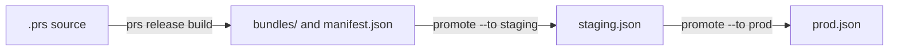

# Releasing Application Prompts

The `bundle` target writes a prompt bundle for every `@prompts` entry. `prs release` turns those
bundles into releases. It stores each bundle under its content hash, and it records which hash each
environment, such as `staging` or `prod`, serves. An application reads the label of its
environment, then the bundle file the label points at.

Read [Application Prompts](application-prompts.md) first. This page covers only the release flow.

## Configuration

Releases are opt-in. List the environments in promotion order, first to last:

```yaml
releases:
  environments: [staging, prod]
```

Without `releases`, every `prs release` command fails with `PS5001` and shows this snippet. See
[`releases`](../reference/config.md#releases) for the name rules.

`policies` are read by every release command. A policy with an unknown kind fails the command, it is
never skipped. Policies parse the same way as in `prs validate`, against `governance.roles`,
`releases.environments` and the model catalog with `models.profiles`, so a role, environment or model
that `validate` refuses fails a release command too.

## Files

All release files live in `.promptscript/releases/` and belong in Git:

```text
.promptscript/releases/
  manifest.json                bundle index of the latest build
  bundles/sha256-<hex>.json    one immutable file per content hash
  staging.json                 label of the staging environment
  prod.json                    label of the prod environment
```

- A bundle file has exactly the bytes the `bundle` target writes. A release never rewrites it and
  never deletes it.
- The manifest is a bundle index of the latest build. Its `file` entries point into `bundles/`.
- A label has one entry per prompt, sorted by id, and lists each id once. The `$schema` is
  `https://getpromptscript.dev/schema/prompt-release-label/v1.json`.

```json
{
  "$schema": "https://getpromptscript.dev/schema/prompt-release-label/v1.json",
  "environment": "prod",
  "prompts": [
    {
      "id": "acme-support/refund-reply",
      "contentHash": "sha256-<64 hex digits>"
    }
  ]
}
```

Release files must be regular files. A symbolic link in `.promptscript`, `.promptscript/releases`,
`bundles/`, or for a release file itself is refused. Names must match in case exactly: a
`Prod.json` or `Manifest.json` is refused, because a case-insensitive disk would read it as the
real file. A manifest or label that does not parse as one is never overwritten, the error tells
you to restore it from Git.

`prs compile` refuses any output inside `.promptscript/releases/` (`PS5008`), and watch mode ignores
that directory. Compile cleanup never removes release files.

## The flow



### Build

```bash
prs release build
```

Build compiles the source in memory. It never reads the compiled `prompts/` directory, and it works
whether or not `bundle` is in `targets`. It writes each new bundle file, checks the ones that exist,
and writes the manifest only when its bytes change. A second run writes nothing. A program without
prompts gives `prompts: []`.

A build always runs with these settings, so a release cannot ship what a normal compile would flag:

- Policies are on. `validation.skipPolicies: true` and `validation.ignoreHashes` in the YAML are
  ignored. Each policy keeps its own `severity`, so only a policy with `severity: error` fails the
  build.
- The security rules PS005 `blocked-patterns`, PS010 `suspicious-urls`, PS011
  `authority-injection`, PS012 `obfuscated-content`, PS013 `path-traversal` and PS014
  `unicode-security` run as errors, whatever `validation.rules` and `validation.disableRules` say.
  When the config switched one off, the error says so.
- `validation.excludes` do not apply to these rules in a release, and imported text is scanned
  like local text. An import excluded from a rule in `prs validate` is still checked when it ships.
  `validation.allowedPatterns` does apply, like in every other command, so a pattern exempted
  there stays exempted.

An existing bundle file that does not verify fails with `PS5004` and the advice to restore it from
Git. Use `--dry-run` to see what would be written.

### Promote

```bash
prs release promote acme-support/refund-reply --to staging
prs release promote acme-support/refund-reply --to prod
```

Promote points an environment at a bundle. The argument is `<id>` or `<id>@<hash>`. The hash is the
full `sha256-<64 hex>` or a prefix of at least 8 hex digits, with or without `sha256-`, matched
among the bundle files of that id. An ambiguous prefix lists the candidates.

The promotion order is fixed and has no escape:

- The first environment recompiles the source like build does and accepts only the fresh hash. A
  hash you give must equal it. Without a hash, the manifest entry must equal it. Otherwise the
  command fails with `PS5004` and tells you to run `prs release build`.
- A later environment accepts only the hash the previous environment holds now. Otherwise the
  command fails with `PS5005` and prints the exact promote command for the previous environment.

There is no `--force`, `--skip-policies` or `--ignore-hashes`. The bundle file must exist (`PS5003`)
and verify with that id (`PS5004`).

Promote warns, without failing, when the new bundle changes inputs compared with the bundle the
environment holds now: a new required input, an input that became required, a removed input, or a
changed type or options. Callers need an update before the release reaches them.

The label is written atomically. Promoting the hash an environment already holds is a no-op with
exit code 0.

### Roll back

```bash
prs release rollback prod
```

Rollback undoes the last committed change of a label. It reads Git history, there is no history
field in the label.

- The label must have no uncommitted change, else `PS5006` tells you to commit it or run
  `git restore`.
- It takes the label as it was before its last commit. At the first promotion nothing is before it,
  and `PS5006` says so.
- In a shallow checkout the commit before may be missing. `PS5006` then tells you to run
  `git fetch --unshallow`.
- The restored label must parse and every hash in it must verify.

A committed rollback is undone by a second rollback, like `helm rollback`. Rollback does not check
the promotion order.

To go further back, restore the label from an older commit with Git. Promote cannot do it: the
first environment takes only the fresh build and every later one only the hash of the environment
before it. Find the commit with `prs release status --history` or `git log`, restore the file, check
it, and commit it in a pull request like any other label change:

```bash
prs release status --history 10
git restore --source=<commit> -- .promptscript/releases/prod.json
prs release status
```

Every rollback `PS5006` message points to this.

### Status

```bash
prs release status
prs release status --history 5
```

Status lists every environment with the prompt id, the hash (12 hex digits), whether the hash is in
the latest build (equals the manifest) and whether the bundle verifies. A missing label means an
empty environment. A label file for an environment that is not configured gives a warning.

Every referenced bundle is verified, and a failure exits with code 1, so CI can run it.
`--history <n>` (1 to 1000) adds the commit, date and subject of the last n commits of each label.
It shows no author names.

## One pull request per promotion

Every promotion is a reviewed pull request, and Git history is the release log:

1. Change the prompts and run `prs release build`.
2. Commit the changed `.prs` source, `promptscript.yaml` and every config file it reaches through
   `extends` together with the new bundle files and the manifest. Open a pull request and merge it.
   Promotion to the first environment recompiles the source with the config on the branch, so a
   build without them fails with `PS5004`.
3. Run `prs release promote <id> --to staging`, commit the label, open a pull request.
4. When staging looks right, run `prs release promote <id> --to prod` in a new pull request.

Roll back the same way: run `prs release rollback prod`, commit the label, open a pull request.

Promote, build and rollback take a project lock, `.promptscript-release.lock`. Another release
command that holds it fails with `PS5007`. A stale lock is broken after its process is gone or after
30 minutes. Dry runs take no lock. Add the lock file to `.gitignore`.

## Approvals

An approval is a small JSON file that says one person approved one exact prompt version in one
role. `prs approve` writes it. The version is the content hash, so a record covers the messages,
the model and the governance values of that bundle, nothing else.

Approvals need `releases` and the roles under `governance.roles`, each with the teams that review
it:

```yaml
releases:
  environments: [staging, prod]
governance:
  roles:
    legal: ['@acme/legal']
    security: ['@acme/appsec']
```

Approve the full hash, for one environment or for all of them:

```bash
prs approve --list acme-support/refund-reply
prs approve acme-support/refund-reply@sha256-<64 hex digits> --role legal --approver @jane --env prod
prs approve acme-support/refund-reply@sha256-<64 hex digits> --role security --approver @bob --all-environments --comment "Checked in PR 123"
```

`--list` prints the hash the checkout builds. The command checks, and fails without writing:

- the role is in `governance.roles` (`PS5101`). A role named like a Windows device (`con`, `nul`,
  `com1`, ...) is refused, since it names a directory.
- the reference is `<id>@sha256-<64 hex>` with a valid prompt id (`PS5102`). A prefix is not
  enough, and no id segment may end with a dot.
- `--env` is a configured environment (`PS5002`), or `--all-environments` is given. One of the two
  is required.
- `--comment` has at most 2000 characters, no control characters except newlines and no invisible
  format characters such as bidi marks.
- `--approver` is a Git host user handle like `@jane` (`PS5104`). An email address or a team is
  refused, so no address ends up in a file name.
- the hash is real (`PS5103`): a bundle in `.promptscript/releases/bundles/` of that prompt that
  verifies, or what the source builds right now. A stored bundle that does not verify is `PS5004`.

Before it writes, the command prints what the hash holds to stderr: the description, governance
values, model, inputs with their defaults and options, output contract and messages. Invisible
characters, such as tag characters or bidi marks, show as `<U+XXXX>`. Read the preview. If it is not
what you meant to approve, delete the record file before you commit it. The command shows no diff
against an earlier version: the pull request diff is that diff. Link it in `--comment` or in the
pull request.

### Record files

```text
.promptscript/approvals/<role>/<prompt id>/<content hash>.<approver>.json
.promptscript/approvals/legal/acme-support/refund-reply/sha256-3f9a...jane.json
```

The approver part is the handle without `@`, lowercased. There is one file per approver, role and
hash. The file holds exactly these bytes, with `environment` only when `--env` was given and
`comment` only when one was given:

```json
{
  "$schema": "https://getpromptscript.dev/schema/approval-record/v1.json",
  "prompt": "acme-support/refund-reply",
  "contentHash": "sha256-<64 hex digits>",
  "role": "legal",
  "approver": {
    "source": "asserted",
    "value": "@jane"
  },
  "createdAt": "2026-10-22T09:14:03.120Z",
  "environment": "prod",
  "comment": "Checked in PR 123"
}
```

A record is never overwritten. When the file exists, the command fails with `PS5105` and exit code 2. To withdraw an approval, delete the file in a commit. To change its environment or comment,
delete it in a commit and approve again.

A record counts only with these exact bytes. The first `prs approve` writes
`.promptscript/approvals/.gitattributes` with `* -text`, so a checkout with `core.autocrlf` never
changes its line endings. Commit that file too. When the file exists without that line, the command
warns and leaves it alone.

The path that counts is the one Git tracks, because CODEOWNERS matches that path, and the bytes
must equal the ones Git has for that path, because those are the reviewed ones. On a
case-insensitive disk, as on macOS and Windows, `Legal/` and `legal/` are one directory, so a record
committed as `Legal/...` shows up under `legal/`, and two such paths share one file on disk.
`--list` therefore compares the path in Git and the blob Git has for it, not only what the disk
shows.

The writer walks the record path from the project root. A symbolic link, a file where a directory
should be, or a name that differs only in case, like `Legal/` next to `legal`, fails with `PS5109`.
It creates the record from a temporary file and links it into place, so an existing name is never
replaced. It takes the release lock `.promptscript-release.lock`, like build and promote.

### Listing approvals

```bash
prs approve --list
prs approve --list acme-support/refund-reply --format json
```

`--list` compiles the source in memory, reads every record, asks Git with `git ls-files -s` which
paths it tracks and which blob each holds, and prints, per prompt, the hash the checkout builds and
each record with its role, approver, scope (`prod` or `all environments`) and state. When there are
record files, it needs Git and a repository, else `PS5108`.

| State            | Meaning                                                          |
| ---------------- | ---------------------------------------------------------------- |
| `current`        | The record approves the hash the checkout builds                 |
| `labelled:<env>` | Not the current hash, but the label of that environment holds it |
| `stale`          | Neither: the prompt changed since                                |
| `untracked`      | Not added to Git yet. A staged record already counts as tracked  |
| `modified`       | The bytes on disk are not the ones Git has for the path          |
| `misplaced`      | Git tracks the file at another path than its fields give         |
| `unknown-role`   | The role is not in `governance.roles`                            |

Only `current` and `labelled` records can count. A file that is no valid record, for example one
with CRLF line endings, gets a `PS5109` warning, and so do modified, misplaced and unknown-role
records. The file name is never trusted alone: the fields decide, and the path in Git must match
them. A record with a `signature` gets a warning, since signatures are not checked in this version.
Links are never followed. At most 10000 files and directories, files of up to 64 KiB each, and 8
directory levels below `.promptscript/approvals/` are read. Git's list of record paths may take up
to 10 MiB; a longer one fails with `PS5108`.

With `--format json`, stdout holds one document that matches
`https://getpromptscript.dev/schema/approval-report/v1.json`.

### What an approval proves

In this version a record is a claim. The approver is whatever `--approver` said, and `createdAt` is
the clock of the machine that wrote it. `prs release promote` does not read records yet.

The binding review is the one on the Git host: the pull request that adds the record, at the path
Git has for it. Give each role directory its own code owners, so a record under `legal/` cannot
merge without a review from `@acme/legal`:

```text
/.promptscript/approvals @acme/prompt-platform
/.promptscript/approvals/legal @acme/legal
/.promptscript/approvals/security @acme/appsec
```

Turn on required code owner review for the branch. The host also stops a pull request author from
approving their own pull request; the CLI does not check that. For "who approved this for prod",
read the review of the pull request that added the record.

## In CI

```bash
set -e
prs release build
test -z "$(git status --porcelain -- .promptscript/releases)"
prs release status
```

Build writes whatever the committed release files miss, so the `test -z` check fails when a pull
request changes prompts without the build. It also catches new bundle files, which
`git diff --exit-code` would not see because they are untracked. `status` fails when a label points
at a bundle that is missing or does not verify. All four commands accept
`--format json`, which prints one document on stdout that matches
`https://getpromptscript.dev/schema/release-report/v1.json`, and prints the human text on stderr.

## What protects the labels

In this version only branch protection and review protect the label files. The CLI checks what it
writes, but a label edited by hand in a pull request is caught only by review. `prs release status`
still checks that the hashes exist and match their bundles.

- Add `.promptscript/releases/`, `promptscript.yaml` and every config file it reaches through
  `extends` to `CODEOWNERS`, and require the review.
- Protect the branch the applications read from.
- An older label served from a cache, or a label on a rewritten branch, cannot be detected in this
  version.

Applications read the label file of their environment and the bundle file it names. Recompute the
content hash before use, as described in [Application Prompts](application-prompts.md#content-hash).

## Error codes

| Code   | Meaning                                                           |
| ------ | ----------------------------------------------------------------- |
| PS5001 | `releases` is missing or invalid                                  |
| PS5002 | The environment is not in `releases.environments`                 |
| PS5003 | A bundle or prompt is missing, or a hash prefix matches nothing   |
| PS5004 | A release file does not verify, or the hash is not the fresh hash |
| PS5005 | The promotion skips the previous environment                      |
| PS5006 | Rollback is not possible                                          |
| PS5007 | Another release command holds the lock                            |
| PS5008 | A compile output lies inside `.promptscript/releases/`            |

`prs approve` uses these codes:

| Code   | Meaning                                                                                        |
| ------ | ---------------------------------------------------------------------------------------------- |
| PS5101 | `governance.roles` is missing or invalid, or the role is not in it                             |
| PS5102 | The reference is not `<id>@sha256-<64 hex>` with a valid prompt id                             |
| PS5103 | The hash is neither what the checkout builds nor a bundle of that prompt                       |
| PS5104 | `--approver` is missing or not a user handle like `@jane`                                      |
| PS5105 | The record exists (exit code 2)                                                                |
| PS5108 | `--list` cannot run Git, or the project is not in a repository                                 |
| PS5109 | A record is invalid, modified, misplaced or has an unknown role, or the record path has a link |

## See Also

- [`prs release` in the CLI reference](../reference/cli.md#prs-release)
- [`releases` in the configuration reference](../reference/config.md#releases)
- [Application Prompts](application-prompts.md)
- [Bundle formatter](../reference/formatters/bundle.md)
- [Policy Engine](policy-engine.md)
