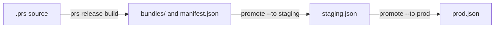

# Releasing Application Prompts

The `bundle` target writes a prompt bundle for every `@prompts` entry. `prs release` turns those
bundles into releases. It stores each bundle under its content hash, and it records which hash each
environment, such as `staging` or `prod`, serves. An application reads the label of its
environment, then the bundle file the label points at.

Read [Application Prompts](application-prompts.md) first. This page covers only the release flow.

## Configuration

Releases are opt-in. List the environments in promotion order, first to last:

```yaml
releases:
  environments: [staging, prod]
```

Without `releases`, every `prs release` command fails with `PS5001` and shows this snippet. See
[`releases`](../reference/config.md#releases) for the name rules.

`policies` are read by every release command. A policy with an unknown kind fails the command, it is
never skipped. Policies parse the same way as in `prs validate`, against `governance.roles`,
`releases.environments` and the model catalog with `models.profiles`, so a role, environment or model
that `validate` refuses fails a release command too.

## Files

All release files live in `.promptscript/releases/` and belong in Git:

```text
.promptscript/releases/
  manifest.json                bundle index of the latest build
  bundles/sha256-<hex>.json    one immutable file per content hash
  staging.json                 label of the staging environment
  prod.json                    label of the prod environment
```

- A bundle file has exactly the bytes the `bundle` target writes. A release never rewrites it and
  never deletes it.
- The manifest is a bundle index of the latest build. Its `file` entries point into `bundles/`.
- A label has one entry per prompt, sorted by id, and lists each id once. The `$schema` is
  `https://getpromptscript.dev/schema/prompt-release-label/v1.json`.

```json
{
  "$schema": "https://getpromptscript.dev/schema/prompt-release-label/v1.json",
  "environment": "prod",
  "prompts": [
    {
      "id": "acme-support/refund-reply",
      "contentHash": "sha256-<64 hex digits>"
    }
  ]
}
```

Release files must be regular files. A symbolic link in `.promptscript`, `.promptscript/releases`,
`bundles/`, or for a release file itself is refused. Names must match in case exactly: a
`Prod.json` or `Manifest.json` is refused, because a case-insensitive disk would read it as the
real file. A manifest or label that does not parse as one is never overwritten, the error tells
you to restore it from Git.

`prs compile` refuses any output inside `.promptscript/releases/` (`PS5008`), and watch mode ignores
that directory. Compile cleanup never removes release files.

## The flow



### Build

```bash
prs release build
```

Build compiles the source in memory. It never reads the compiled `prompts/` directory, and it works
whether or not `bundle` is in `targets`. It writes each new bundle file, checks the ones that exist,
and writes the manifest only when its bytes change. A second run writes nothing. A program without
prompts gives `prompts: []`.

A build always runs with these settings, so a release cannot ship what a normal compile would flag:

- Policies are on. `validation.skipPolicies: true` and `validation.ignoreHashes` in the YAML are
  ignored. Each policy keeps its own `severity`, so only a policy with `severity: error` fails the
  build.
- The security rules PS005 `blocked-patterns`, PS010 `suspicious-urls`, PS011
  `authority-injection`, PS012 `obfuscated-content`, PS013 `path-traversal` and PS014
  `unicode-security` run as errors, whatever `validation.rules` and `validation.disableRules` say.
  When the config switched one off, the error says so.
- `validation.excludes` do not apply to these rules in a release, and imported text is scanned
  like local text. An import excluded from a rule in `prs validate` is still checked when it ships.
  `validation.allowedPatterns` does apply, like in every other command, so a pattern exempted
  there stays exempted.

An existing bundle file that does not verify fails with `PS5004` and the advice to restore it from
Git. Use `--dry-run` to see what would be written.

### Promote

```bash
prs release promote acme-support/refund-reply --to staging
prs release promote acme-support/refund-reply --to prod
```

Promote points an environment at a bundle. The argument is `<id>` or `<id>@<hash>`. The hash is the
full `sha256-<64 hex>` or a prefix of at least 8 hex digits, with or without `sha256-`, matched
among the bundle files of that id. An ambiguous prefix lists the candidates.

The promotion order is fixed and has no escape:

- The first environment recompiles the source like build does and accepts only the fresh hash. A
  hash you give must equal it. Without a hash, the manifest entry must equal it. Otherwise the
  command fails with `PS5004` and tells you to run `prs release build`.
- A later environment accepts only the hash the previous environment holds now. Otherwise the
  command fails with `PS5005` and prints the exact promote command for the previous environment.

There is no `--force`, `--skip-policies` or `--ignore-hashes`. The bundle file must exist (`PS5003`)
and verify with that id (`PS5004`).

Promote warns, without failing, when the new bundle changes inputs compared with the bundle the
environment holds now: a new required input, an input that became required, a removed input, or a
changed type or options. Callers need an update before the release reaches them.

The label is written atomically. Promoting the hash an environment already holds is a no-op with
exit code 0.

### Roll back

```bash
prs release rollback prod
```

Rollback undoes the last committed change of a label. It reads Git history, there is no history
field in the label.

- The label must have no uncommitted change, else `PS5006` tells you to commit it or run
  `git restore`.
- It takes the label as it was before its last commit. At the first promotion nothing is before it,
  and `PS5006` says so.
- In a shallow checkout the commit before may be missing. `PS5006` then tells you to run
  `git fetch --unshallow`.
- The restored label must parse and every hash in it must verify.

A committed rollback is undone by a second rollback, like `helm rollback`. Rollback does not check
the promotion order.

To go further back, restore the label from an older commit with Git. Promote cannot do it: the
first environment takes only the fresh build and every later one only the hash of the environment
before it. Find the commit with `prs release status --history` or `git log`, restore the file, check
it, and commit it in a pull request like any other label change:

```bash
prs release status --history 10
git restore --source=<commit> -- .promptscript/releases/prod.json
prs release status
```

Every rollback `PS5006` message points to this.

### Status

```bash
prs release status
prs release status --history 5
```

Status lists every environment with the prompt id, the hash (12 hex digits), whether the hash is in
the latest build (equals the manifest) and whether the bundle verifies. A missing label means an
empty environment. A label file for an environment that is not configured gives a warning.

Every referenced bundle is verified, and a failure exits with code 1, so CI can run it.
`--history <n>` (1 to 1000) adds the commit, date and subject of the last n commits of each label.
It shows no author names.

## One pull request per promotion

Every promotion is a reviewed pull request, and Git history is the release log:

1. Change the prompts and run `prs release build`.
2. Commit the changed `.prs` source, `promptscript.yaml` and every config file it reaches through
   `extends` together with the new bundle files and the manifest. Open a pull request and merge it.
   Promotion to the first environment recompiles the source with the config on the branch, so a
   build without them fails with `PS5004`.
3. Run `prs release promote <id> --to staging`, commit the label, open a pull request.
4. When staging looks right, run `prs release promote <id> --to prod` in a new pull request.

Roll back the same way: run `prs release rollback prod`, commit the label, open a pull request.

Promote, build and rollback take a project lock, `.promptscript-release.lock`. Another release
command that holds it fails with `PS5007`. A stale lock is broken after its process is gone or after
30 minutes. Dry runs take no lock. Add the lock file to `.gitignore`.

## In CI

```bash
set -e
prs release build
test -z "$(git status --porcelain -- .promptscript/releases)"
prs release status
```

Build writes whatever the committed release files miss, so the `test -z` check fails when a pull
request changes prompts without the build. It also catches new bundle files, which
`git diff --exit-code` would not see because they are untracked. `status` fails when a label points
at a bundle that is missing or does not verify. All four commands accept
`--format json`, which prints one document on stdout that matches
`https://getpromptscript.dev/schema/release-report/v1.json`, and prints the human text on stderr.

## What protects the labels

In this version only branch protection and review protect the label files. The CLI checks what it
writes, but a label edited by hand in a pull request is caught only by review. `prs release status`
still checks that the hashes exist and match their bundles.

- Add `.promptscript/releases/`, `promptscript.yaml` and every config file it reaches through
  `extends` to `CODEOWNERS`, and require the review.
- Protect the branch the applications read from.
- An older label served from a cache, or a label on a rewritten branch, cannot be detected in this
  version.

Applications read the label file of their environment and the bundle file it names. Recompute the
content hash before use, as described in [Application Prompts](application-prompts.md#content-hash).

## Error codes

| Code   | Meaning                                                           |
| ------ | ----------------------------------------------------------------- |
| PS5001 | `releases` is missing or invalid                                  |
| PS5002 | The environment is not in `releases.environments`                 |
| PS5003 | A bundle or prompt is missing, or a hash prefix matches nothing   |
| PS5004 | A release file does not verify, or the hash is not the fresh hash |
| PS5005 | The promotion skips the previous environment                      |
| PS5006 | Rollback is not possible                                          |
| PS5007 | Another release command holds the lock                            |
| PS5008 | A compile output lies inside `.promptscript/releases/`            |

## See Also

- [`prs release` in the CLI reference](../reference/cli.md#prs-release)
- [`releases` in the configuration reference](../reference/config.md#releases)
- [Application Prompts](application-prompts.md)
- [Bundle formatter](../reference/formatters/bundle.md)
- [Policy Engine](policy-engine.md)
