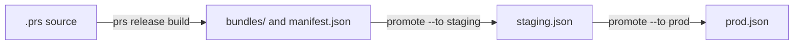

# Releasing Application Prompts

The `bundle` target writes a prompt bundle for every `@prompts` entry. `prs release` turns those
bundles into releases. It stores each bundle under its content hash, and it records which hash each
environment, such as `staging` or `prod`, serves. An application reads the label of its
environment, then the bundle file the label points at.

Read [Application Prompts](application-prompts.md) first. This page covers only the release flow.

## Configuration

Releases are opt-in. List the environments in promotion order, first to last:

```yaml
releases:
  environments: [staging, prod]
```

Without `releases`, every `prs release` command fails with `PS5001` and shows this snippet. See
[`releases`](../reference/config.md#releases) for the name rules.

`policies` are read by every release command. A policy with an unknown kind fails the command, it is
never skipped. Policies parse the same way as in `prs validate`, against `governance.roles`,
`releases.environments` and the model catalog with `models.profiles`, so a role, environment or model
that `validate` refuses fails a release command too.

## Files

All release files live in `.promptscript/releases/` and belong in Git:

```text
.promptscript/releases/
  manifest.json                bundle index of the latest build
  pricing.json                 list prices of the models the bundles use
  bundles/sha256-<hex>.json    one immutable file per content hash
  staging.json                 label of the staging environment
  prod.json                    label of the prod environment
```

- A bundle file has exactly the bytes the `bundle` target writes. A release never rewrites it and
  never deletes it.
- The manifest is a bundle index of the latest build. Its `file` entries point into `bundles/`.
- `pricing.json` lists, for each model that a bundle in `bundles/` uses and that has a price in the
  model catalog (built-in profiles plus `models.profiles` of the project), `ref`, `apiId`,
  `provider`, `inputUsdPerMillion`, `outputUsdPerMillion` and `checkedOn`, sorted by `ref`. The
  `ref` is the catalog profile id, not the reference the prompt author wrote. Older bundles stay
  in the list, so a label that still serves one keeps its price. A model without a price is left
  out. When two profiles share a provider and API id with different prices, the lowest profile id
  wins and the build warns. The file is not part of any content hash, so a price change never
  changes a bundle, an approval or a gate. It has no timestamp, so the same sources and catalog
  give the same bytes, and `prs release build` plus `git diff --exit-code` in CI shows a hand edit.
  Prices are list prices and ignore cache and batch discounts, so treat them as an estimate. Its
  `$schema` is `https://getpromptscript.dev/schema/prompt-release-pricing/v1.json`. The name
  `pricing` cannot be an environment. A project that already has an environment called `pricing`
  renames it and moves `.promptscript/releases/pricing.json` to the new name.
- A label has one entry per prompt, sorted by id, and lists each id once. The `$schema` is
  `https://getpromptscript.dev/schema/prompt-release-label/v1.json`.

```json
{
  "$schema": "https://getpromptscript.dev/schema/prompt-release-label/v1.json",
  "environment": "prod",
  "prompts": [
    {
      "id": "acme-support/refund-reply",
      "contentHash": "sha256-<64 hex digits>"
    }
  ]
}
```

While an entry runs an experiment (see [Split](#split)), the label is version 2. Its `$schema` is
`https://getpromptscript.dev/schema/prompt-release-label/v2.json` and the entry has an
`experiment` with its arms. Weights are basis points and add up to 10000. The label goes back to
version 1, byte for byte what a plain label looks like, when the last experiment ends.

```json
{
  "$schema": "https://getpromptscript.dev/schema/prompt-release-label/v2.json",
  "environment": "prod",
  "prompts": [
    {
      "id": "acme-support/refund-reply",
      "contentHash": "sha256-<64 hex digits of control>",
      "experiment": {
        "name": "warm-tone-2026-11",
        "arms": [
          {
            "variant": "control",
            "contentHash": "sha256-<64 hex digits of control>",
            "weight": 9000
          },
          { "variant": "warm", "contentHash": "sha256-<64 hex digits of warm>", "weight": 1000 }
        ]
      }
    }
  ]
}
```

Release files must be regular files. A symbolic link in `.promptscript`, `.promptscript/releases`,
`bundles/`, or for a release file itself is refused. Names must match in case exactly: a
`Prod.json` or `Manifest.json` is refused, because a case-insensitive disk would read it as the
real file. A manifest, pricing file or label that does not parse as one is never overwritten, the
error tells you to restore it from Git.

`prs compile` refuses any output inside `.promptscript/releases/` (`PS5008`), and watch mode ignores
that directory. Compile cleanup never removes release files.

## The flow



### Build

```bash
prs release build
```

Build compiles the source in memory. It never reads the compiled `prompts/` directory, and it works
whether or not `bundle` is in `targets`. It writes each new bundle file, checks the ones that exist,
reads every `sha256-*.json` in `bundles/` for `pricing.json` and stops with PS5004, before it
writes anything, on one that does not verify, and writes the manifest and `pricing.json` only when
their bytes change. A second run writes nothing. A program without prompts gives `prompts: []`.

A build always runs with these settings, so a release cannot ship what a normal compile would flag:

- Policies are on. `validation.skipPolicies: true` and `validation.ignoreHashes` in the YAML are
  ignored. Each policy keeps its own `severity`, so only a policy with `severity: error` fails the
  build.
- The security rules PS005 `blocked-patterns`, PS010 `suspicious-urls`, PS011
  `authority-injection`, PS012 `obfuscated-content`, PS013 `path-traversal` and PS014
  `unicode-security` run as errors, whatever `validation.rules` and `validation.disableRules` say.
  When the config switched one off, the error says so.
- `validation.excludes` do not apply to these rules in a release, and imported text is scanned
  like local text. An import excluded from a rule in `prs validate` is still checked when it ships.
  `validation.allowedPatterns` does apply, like in every other command, so a pattern exempted
  there stays exempted.

An existing bundle file that does not verify fails with `PS5004` and the advice to restore it from
Git. Use `--dry-run` to see what would be written.

### Promote

```bash
prs release promote acme-support/refund-reply --to staging
prs release promote acme-support/refund-reply --to prod
```

Promote points an environment at a bundle. The argument is `<id>` or `<id>@<hash>`. The hash is the
full `sha256-<64 hex>` or a prefix of at least 8 hex digits, with or without `sha256-`, matched
among the bundle files of that id. An ambiguous prefix lists the candidates.

The promotion order is fixed and has no escape:

- The first environment recompiles the source like build does and accepts only the fresh hash. A
  hash you give must equal it. Without a hash, the manifest entry must equal it. Otherwise the
  command fails with `PS5004` and tells you to run `prs release build`.
- A later environment accepts only the hash the previous environment holds now. Otherwise the
  command fails with `PS5005` and prints the exact promote command for the previous environment.

There is no `--force`, `--skip-policies` or `--ignore-hashes`. The bundle file must exist (`PS5003`)
and verify with that id (`PS5004`).

Promote warns, without failing, when the new bundle changes inputs compared with the bundle the
environment holds now: a new required input, an input that became required, a removed input, or a
changed type or options. Callers need an update before the release reaches them.

Before the label is written, inside the lock, the prompt version must pass the
[release gates](#release-gates). The label is written atomically. Promoting the hash an
environment already holds is a no-op with exit code 0.

### Roll back

```bash
prs release rollback prod
```

Rollback undoes the last committed change of a label. It reads Git history, there is no history
field in the label.

- The label must have no uncommitted change, else `PS5006` tells you to commit it or run
  `git restore`.
- It takes the label as it was before its last commit. At the first promotion nothing is before it,
  and `PS5006` says so.
- In a shallow checkout the commit before may be missing. `PS5006` then tells you to run
  `git fetch --unshallow`.
- The restored label must parse and every hash in it must verify.
- The label comes back whole, version 1 or version 2. Every hash of a changed entry, experiment
  arms included, is verified and goes through the [release gates](#release-gates) with the records
  committed now: the entry hash and every arm with traffic. An entry the rollback leaves as it is
  is not judged again.
- An experiment is never brought back into the first environment (`PS5009`).

A committed rollback is undone by a second rollback, like `helm rollback`. Rollback does not check
the promotion order.

To go further back, restore the label from an older commit with Git. Promote cannot do it: the
first environment takes only the fresh build and every later one only the hash of the environment
before it. Find the commit with `prs release status --history` or `git log`, restore the file, check
it, and commit it in a pull request like any other label change:

```bash
prs release status --history 10
git restore --source=<commit> -- .promptscript/releases/prod.json
prs release status
```

Every rollback `PS5006` message points to this.

### Split

**Before the first `prs release split` in an environment, every application reading that
environment must run a runtime that reads label v2.** An older runtime keeps serving stale prompts
and calls `onError` on every refresh. An older `prs` refuses a v2 label with `PS5004`.

```bash
# Start: 10 % of the keys get the version staging holds, control keeps the rest
prs release split acme-support/refund-reply --env prod --name warm-tone-2026-11 \
  --arm warm@sha256-1a2b3c4d=10

# Change the share, or add an arm; --arm lists every arm that stays
prs release split acme-support/refund-reply --env prod --name warm-tone-2026-11 \
  --arm warm@sha256-1a2b3c4d=25

# End: back to the entry hash, or keep an arm as the entry
prs release split acme-support/refund-reply --env prod --end
prs release split acme-support/refund-reply --env prod --end --keep warm
```

Split sends a share of the traffic of one prompt to another version that the previous environment already runs. Control is
the entry hash of the label and gets the rest of the traffic, at least 0.01 %. An arm is
`<variant>@<hash>=<percent>`; the hash is a full hash or a prefix of at least 8 hex digits, matched
among the bundle files of the id. `--dry-run` shows the result without writing.

Rules of the arms:

- No experiment in the first environment (`PS5009`). It follows the source. A project with one
  environment adds a later one first, for example `staging`.
- At most 4 arms with control, so at most 3 `--arm`. Percents have at most two decimals and are
  stored as basis points.
- `--arm` lists every arm that stays. An arm left out is removed. Arms that stay keep their order
  and new ones go to the end, so a key keeps its bucket when you add an arm.
- A variant keeps its hash for the life of the experiment. To serve another version, use a new arm
  name and leave the old one out or at weight 0.
- `--name` is required when you start or change an experiment. A running experiment cannot get
  another name: end it first.
- An arm cannot use the entry hash or the hash of another arm.

Order, like promote:

- A new arm must be the entry of the previous environment or an arm with traffic there.
- An arm that is only an arm upstream runs at most its upstream weight here. An arm that is the
  entry of the previous environment can run up to 99.99 %.
- `--end --keep <variant>` makes an arm the entry, so that hash must be the entry of the previous
  environment.
- When the previous environment stops an arm, the next write here must pause it (weight 0) or
  remove it. Weight 0 always passes this rule.

Every write passes the checks in this order, then the label is written under the lock: the bundle
of every hash exists and verifies (`PS5003`, `PS5004`), the order rules (`PS5005`), the
[release gates](#release-gates). The gates run for the entry hash and for every arm with traffic,
also when only a weight changed. An arm at weight 0 serves nothing and is judged the moment a
write gives it traffic. `--end` runs the gates for the entry hash, so a revoked approval of it
blocks ending too. A no-op, the same split again, exits with code 0.

Which versions can be an arm is decided by the previous environment, not by what you built. In
staging the only arm with traffic is the version dev holds now. In prod arms come from the staging
entry or from the staging arm. The recommended path is a canary: promote the new version X to
staging, run `split --env prod --arm warm@X=<percent>` up to 99.99 %, and when it holds, end it with
`--end --keep warm` once staging is the entry. A promote upstream freezes the experiment
downstream: the next write there must pause or end it. "At most 4 arms" is a limit of the label; in
a short chain of environments the extra arms can only sit at weight 0.

If the approval of control is revoked while an experiment runs, `--end` is blocked too (it judges
the entry hash). Re-approve control, or end the experiment onto an approved hash. A hand edit of
the label that keeps the entry hash is gated the same way and fails like `--end`.

Approvals and evals bind to a hash, not to a weight. Without an exposure policy, moving an arm from
1 % to 99 % passes when 1 % did. Treat a weight change as a release: put CODEOWNERS on
`.promptscript/releases/` and review it. A `max-experiment-weight` policy changes that: the gates
judge the weight of every arm with traffic in split, rollback and `status --base`, and warn in plain
`status`. Up to `maxWeight` an arm needs nothing. If the policy defines `approvals`, a higher weight
needs a record from each role that covers the weight, made with
`prs approve --env <env> --max-weight <percent>`. Without `approvals`, `maxWeight` is a hard cap.
Above `ceiling` nothing passes. An arm at weight 0, the entry hash and the control arm are not judged. See
[Max Experiment Weight](policy-engine.md#max-experiment-weight).

A promote on an entry with a running experiment is refused with `PS5010`, so it can never drop
arms. End the experiment first.

Traffic is assigned by the runtime. The bucket of a key is the first 8 hex digits of
`sha256("promptscript-assign-v1\0" + experiment + "\0" + id + "\0" + key)` as a 32-bit integer
modulo 10000, and the arm is the first one in label order whose cumulative weight is above the
bucket. A read without a key gets the entry hash, untagged. The modulo bias is below 3e-6. The
exact rules and test vectors are in the
[conformance vectors](https://github.com/mrwogu/promptscript/blob/main/conformance/prompt-release-label/v2/README.md).

### Status

```bash
prs release status
prs release status --history 5
```

Status lists every environment with the prompt id, the hash (12 hex digits), whether the hash is in
the latest build (equals the manifest) and whether the bundle verifies. A missing label means an
empty environment. A label file for an environment that is not configured gives a warning.

Under an entry with an experiment status lists every arm with its weight. Every referenced bundle,
arms included, is verified, and a failure exits with code 1, so CI can run it.
`--history <n>` (1 to 1000) adds the commit, date and subject of the last n commits of each label.
It shows no author names.

With prompt policies, status also runs the [release gates](#release-gates) on every entry and adds
an `approvals` column: `ok`, `missing: <roles>`, or `-` when no `required-approvals` policy applies.
Plain status only reports: a gate that fails is a warning and the exit code does not change. The
check that fails on it is `--base`.

#### Check the models of the labels

```bash
prs release status --check-models
prs release status --check-models --retiring-within 14
```

`--check-models` reads the model of every verified bundle that a label holds and checks it against
the [model catalog](../reference/models.md). It looks at every entry and at every experiment arm
besides control, an arm with weight 0 too, because a 0 arm can be ramped up without another check.
A bundle that is missing or does not verify gives `PS5003` or `PS5004` as before and no model line.

A model is retiring when the catalog marks it `retired`, or marks it `deprecated` with a
retirement date that is not later than today plus `--retiring-within` days (0 to 3650, default
30; today is the UTC date). A date that has already passed counts. Each one is a `PS5011` error
at the label, with the environment, the prompt, the short hash, the arm, the
model, the date and the replacement from the catalog, and the exit code is 1. A `deprecated`
model with a later date, or with no date, is listed and does not fail. A model the catalog does
not know gives a warning only.

The catalog is the one of the `prs` you run, plus `models.profiles` of the checkout, the same as
`prs release build` uses for prices. The built-in part changes with each `prs` release, so run the
newest CLI to see current dates. A profile in `models.profiles` can change a built-in status. The
profile that is judged is the one whose provider and API id equal the bundle's, so a floating
alias in the source is not re-resolved to a newer model here.

`PS041` checks the model of the source when you validate. This check covers what the labels run,
so it also finds a released bundle whose source has moved on. In text output a Models section lists
every labelled model, and control characters of label and bundle values are removed. In JSON the
report has a `models` list with one item per labelled hash (`environment`, `prompt`,
`contentHash`, `variant` for an arm, `ref`, `profile`, `provider`, `apiId`, `status`,
`retirementDate`, `retiring`), with the values as they are in the files. Without `--check-models`
the list is absent.

## One pull request per promotion

Every promotion is a reviewed pull request, and Git history is the release log:

1. Change the prompts and run `prs release build`.
2. Commit the changed `.prs` source, `promptscript.yaml` and every config file it reaches through
   `extends` together with the new bundle files and the manifest. Open a pull request and merge it.
   Promotion to the first environment recompiles the source with the config on the branch, so a
   build without them fails with `PS5004`.
3. Run `prs release promote <id> --to staging`, commit the label, open a pull request.
4. When staging looks right, run `prs release promote <id> --to prod` in a new pull request.

Roll back the same way: run `prs release rollback prod`, commit the label, open a pull request.
`prs release status --base` lets that pass, see below. Going back further than the last change is a
new promotion under the promote rules.

Promote, split, build and rollback take a project lock, `.promptscript-release.lock`. Another release
command that holds it fails with `PS5007`. A stale lock is broken after its process is gone or after
30 minutes. Dry runs take no lock. Add the lock file to `.gitignore`.

## Approvals

An approval is a small JSON file that says one person approved one exact prompt version in one
role. `prs approve` writes it. The version is the content hash, so a record covers the messages,
the model and the governance values of that bundle, nothing else.

Approvals need `releases` and the roles under `governance.roles`, each with the teams that review
it:

```yaml
releases:
  environments: [staging, prod]
governance:
  roles:
    legal: ['@acme/legal']
    security: ['@acme/appsec']
```

Approve the full hash, for one environment or for all of them:

```bash
prs approve --list acme-support/refund-reply
prs approve acme-support/refund-reply@sha256-<64 hex digits> --role legal --approver @jane --env prod
prs approve acme-support/refund-reply@sha256-<64 hex digits> --role security --approver @bob --all-environments --comment "Checked in PR 123"
prs approve acme-support/refund-reply@sha256-<64 hex digits> --role legal --approver @jane --env prod --max-weight 25
```

`--list` prints the hash the checkout builds. The command checks, and fails without writing:

- the role is in `governance.roles` (`PS5101`). A role named like a Windows device (`con`, `nul`,
  `com1`, ...) is refused, since it names a directory.
- the reference is `<id>@sha256-<64 hex>` with a valid prompt id (`PS5102`). A prefix is not
  enough, and no id segment may end with a dot.
- `--env` is a configured environment (`PS5002`), or `--all-environments` is given. One of the two
  is required.
- `--max-weight <percent>` is a percent from 0.01 to 100 with at most two decimals, such as `5` or
  `2.5`, and comes with `--env` (`PS5110`). It is refused with `--all-environments`: a capped
  approval counts in one environment only. See [Capped approvals](#capped-approvals).
- `--comment` has at most 2000 characters, no control characters except newlines and no invisible
  format characters such as bidi marks.
- `--approver` is a Git host user handle like `@jane` (`PS5104`): `@`, a letter or digit, then
  letters, digits, `_`, `.` or `-`, never two of `_.-` in a row and none at the end. Approver handles
  are limited to 100 characters after the `@`, since the handle is part of the file name. That is the same rule as a
  user owner in `governance`, so GitLab handles like `@jane.doe` and GitHub managed user handles like
  `@jane_acme` work. An email address or a team is refused, so no address ends up in a file name.
- the hash is real (`PS5103`): a bundle in `.promptscript/releases/bundles/` of that prompt that
  verifies, or what the source builds right now. A stored bundle that does not verify is `PS5004`.

Before it writes, the command prints what the hash holds to stderr: the description, governance
values, model, inputs with their defaults and options, output contract and messages. Invisible
characters, such as tag characters or bidi marks, show as `<U+XXXX>`. Read the preview. If it is not
what you meant to approve, delete the record file before you commit it. The command shows no diff
against an earlier version: the pull request diff is that diff. Link it in `--comment` or in the
pull request.

### Record files

```text
.promptscript/approvals/<role>/<prompt id>/<content hash>.<approver>.json
.promptscript/approvals/legal/acme-support/refund-reply/sha256-3f9a...jane.json
```

The approver part is the handle without `@`, lowercased, so `@Jane.Doe` writes
`<content hash>.jane.doe.json`. There is one file per approver, role and hash.

On Windows a long prompt id plus a long handle can go over the 260 character `MAX_PATH` limit. Run
`git config core.longpaths true` in the repository if Git can not check out or add a record.

The file holds exactly these bytes, with `environment` only when `--env` was given, `comment` only
when one was given and `maxWeight` only when `--max-weight` was given:

```json
{
  "$schema": "https://getpromptscript.dev/schema/approval-record/v1.json",
  "prompt": "acme-support/refund-reply",
  "contentHash": "sha256-<64 hex digits>",
  "role": "legal",
  "approver": {
    "source": "asserted",
    "value": "@jane"
  },
  "createdAt": "2026-10-22T09:14:03.120Z",
  "environment": "prod",
  "comment": "Checked in PR 123"
}
```

A record is never overwritten. When the file exists, the command fails with `PS5105` and exit code 2. To withdraw an approval, delete the file in a commit. To change its environment, comment or
ceiling, delete it and approve again in the same change: the file has to go away in that commit,
else `PS5105` refuses the new record. The gate suggests `--max-weight` for an arm even when the
approver already has a lower capped record, and that is the case this covers.

`maxWeight` is a whole number of basis points from 1 to 10000, so `--max-weight 25` writes
`"maxWeight": 2500`. See [Capped approvals](#capped-approvals) for what it changes. A record with
`maxWeight` always names its `environment`: a capped approval counts in one environment only, and a
file with `maxWeight` and no `environment` is no valid record. An older `prs` reads a record with
`maxWeight` as invalid and never counts it: `prs approve --list` warns with `PS5109` and
`prs audit log` shows `state=invalid`. Upgrade CI and the people who audit together before anyone
writes a capped record.

A record counts only with these exact bytes. The first `prs approve` writes
`.promptscript/approvals/.gitattributes` with `* -text`, so a checkout with `core.autocrlf` never
changes its line endings. Commit that file too. When the file exists without that line, the command
warns and leaves it alone.

The path that counts is the one Git tracks, because CODEOWNERS matches that path, and the bytes
must equal the ones Git has for that path, because those are the reviewed ones. On a
case-insensitive disk, as on macOS and Windows, `Legal/` and `legal/` are one directory, so a record
committed as `Legal/...` shows up under `legal/`, and two such paths share one file on disk.
`--list` therefore compares the path in Git and the blob Git has for it, not only what the disk
shows.

The writer walks the record path from the project root. A symbolic link, a file where a directory
should be, or a name that differs only in case, like `Legal/` next to `legal`, fails with `PS5109`.
It creates the record from a temporary file and links it into place, so an existing name is never
replaced. It takes the release lock `.promptscript-release.lock`, like build and promote.

### Listing approvals

```bash
prs approve --list
prs approve --list acme-support/refund-reply --format json
```

`--list` compiles the source in memory, reads every record, asks Git with `git ls-files -s` which
paths it tracks and which blob each holds, and prints, per prompt, the hash the checkout builds and
each record with its role, approver, scope (`prod`, `all environments`, or `prod up to 25 %` for a capped record) and state. When there are
record files, it needs Git and a repository, else `PS5108`.

| State            | Meaning                                                          |
| ---------------- | ---------------------------------------------------------------- |
| `current`        | The record approves the hash the checkout builds                 |
| `labelled:<env>` | Not the current hash, but the label of that environment holds it |
| `stale`          | Neither: the prompt changed since                                |
| `untracked`      | Not added to Git yet. A staged record already counts as tracked  |
| `modified`       | The bytes on disk are not the ones Git has for the path          |
| `misplaced`      | Git tracks the file at another path than its fields give         |
| `unknown-role`   | The role is not in `governance.roles`                            |

Only `current` and `labelled` records can count. A file that is no valid record, for example one
with CRLF line endings, gets a `PS5109` warning, and so do modified, misplaced and unknown-role
records. The file name is never trusted alone: the fields decide, and the path in Git must match
them. A record with a `signature` gets a warning, since signatures are not checked in this version.
Links are never followed. At most 10000 files and directories, files of up to 64 KiB each, and 8
directory levels below `.promptscript/approvals/` are read. Git's list of record paths may take up
to 10 MiB; a longer one fails with `PS5108`.

With `--format json`, stdout holds one document that matches
`https://getpromptscript.dev/schema/approval-report/v1.json`.

### Capped approvals

A record with `maxWeight` approves traffic, not a promotion. It counts only for an experiment arm
whose weight is at or under the ceiling. It never approves the entry hash, the control arm, a
promote, `prs release split --end --keep` or a plain rollback, also not at `--max-weight 100`. A
record without `maxWeight` is a full approval and counts everywhere, for an arm at any weight. Use
`--max-weight` for a `max-experiment-weight` policy, see
[Max Experiment Weight](policy-engine.md#max-experiment-weight): a legal reviewer can sign off a
canary at 5 % without signing off the prompt for everyone.

The gate lists a capped record that did not count as `capped` next to the approvers found. To raise
a ceiling, delete the old record file and run `prs approve` again with a higher `--max-weight` in the
same change. `prs approve` stops with `PS5105` while the old file exists.

### What an approval proves

In this version a record is a claim. The approver is whatever `--approver` said, and `createdAt` is
the clock of the machine that wrote it. The [release gates](#release-gates) count records, but only
committed ones at their own path.

The binding review is the one on the Git host: the pull request that adds the record, at the path
Git has for it. Give each role directory its own code owners, so a record under `legal/` cannot
merge without a review from `@acme/legal`. `prs governance codeowners` writes these lines from
`governance`, see [CODEOWNERS from Governance](codeowners.md). By hand they look like this:

```text
/promptscript.yaml @acme/prompt-platform
/shared/base.yaml @acme/prompt-platform
/.promptscript/releases @acme/prompt-platform
/.github/CODEOWNERS @acme/prompt-platform
/.promptscript/approvals @acme/prompt-platform
/.promptscript/approvals/legal @acme/legal
/.promptscript/approvals/security @acme/appsec
```

The admin lines cover what decides which review a record needs: the config and every file its
`extends` reaches (here `shared/base.yaml`), the release files and the CODEOWNERS file itself.

Turn on required code owner review for the branch. The host also stops a pull request author from
approving their own pull request; the CLI does not check that. For "who approved this for prod",
[`prs audit log`](#audit-log) names the record and the commit that added it; read the review of
the pull request of that commit. A `well-formed` record there only has the right bytes at the
right path. It does not mean a gate accepts it, and the review by the role team lives in the
review log of the Git host, not in Git.

## Release gates

The gates are the prompt policies, run on the prompt version a label is about to hold. They run
in `prs release promote` and `prs release split` before the label is written, in
`prs release rollback` for every hash it brings back, in `prs release status --base` for every
entry that changed, and in plain `prs release status` for every entry, where they only warn. For an
entry with an experiment they judge the entry hash and every arm with traffic. There is no flag or
setting around them: they call the policy evaluators themselves, so `validation.disableRules`,
`validation.rules`, custom rules and `--skip-policies` do not apply. `validation.blockedPatterns`
and `validation.allowedPatterns` do apply, like everywhere else.

Without a prompt policy the gates pass and nothing else runs. With one:

- The policies are parsed again. A policy that does not parse fails every gate.
- The source is built in memory, with the same settings as `prs release build`. A source that does
  not build fails the gates, also for a rollback: fix the source, or change the policy in a
  reviewed pull request.
- The policy risk is the highest of the bundle's risk, the source's risk and the floors of both.
  `match` sees the domain of either and the data classes of both. A bundle file only verifies
  against its own hash, so a bundle with lowered governance values still falls under the policies
  the source falls under.
- `required-metadata`, `risk-floor`, `model-allowlist` and `content-rules` judge the bundle that
  ships: its governance, model, inputs and messages.
- `required-approvals` counts approval records for that prompt, hash and environment.
  `required-evals` is `unavailable`, see
  [Policy Engine](policy-engine.md#required-approvals-and-required-evals).
- `max-experiment-weight` judges the weight of an experiment arm with traffic, with the records that
  cover that weight, see [Policy Engine](policy-engine.md#max-experiment-weight).

A check of severity `error` that fails, or is `unavailable`, fails the command with a `PS030` error
that names the policy and what to do. A check of severity `warning` is a warning. The skill policy
kinds are not part of the gates, they run as `PS030` in the source build.

### Which approvals count

The gates read the records committed at `HEAD`, with `git ls-tree -r HEAD`, never the disk or the
index. A record that is only staged, or edited and not committed, does not count. `prs approve
--list` reads the index, so it shows a staged record as `current` while the gates do not count it
yet.

`status --base` on a pull request counts the records the pull request adds, and the gate cannot
tell who wrote them. A record binds only through review: each `.promptscript/approvals/<role>/`
needs that role's team as code owners, with required code owner review on the branch (see
[What an approval proves](#what-an-approval-proves)). `prs governance codeowners` writes those
lines, see [CODEOWNERS from Governance](codeowners.md). Without it, any author can add a record in
another person's name and pass the gate.

A record counts for one approver when:

- its fields name the prompt, the hash and the role, and `environment` is the one promoted to, or
  absent;
- its committed path is the one its fields give, `.promptscript/approvals/<role>/<prompt id>/...`.
  CODEOWNERS protects records by that path, so a record anywhere else had the wrong reviewers;
- the role is still in `governance.roles`;
- the bytes are a valid v1 record;
- it has no `maxWeight`, or the item is an arm whose weight is at or under `maxWeight`. A record
  with `maxWeight` never approves the entry hash. A record without it counts as a ceiling of
  100 %, so existing records keep working.

An approver counts once per role, compared lowercased. A record of the same prompt and role for
another hash shows as stale. Two committed paths under `.promptscript/approvals/` that differ only
in case fail the gates with `PS5109`: a case-insensitive disk keeps one of them. A committed file
over 64 KiB is no record and does not count. When Git cannot list or read the records, for example
git is not on PATH or an object is missing, the gates fail with `PS5108` and do not count zero
approvals.

`prs release status --base <ref>` takes the policies, governance and releases of `<ref>`, and the
records committed at `HEAD`.

### Output

```text
Gates for acme-support/refund-reply@sha256-3f9a1c2b4d5e to prod (policy risk: high)
  passed       high-risk-models  model-allowlist
  failed       high-risk-signoff  legal 0 of 1 (stale: @bob for sha256-91bc0d2e1a2b)
  failed       high-risk-exposure  legal 0 of 1 (capped: @bob up to 10 %)
  unavailable  prod-evals  acme-support/refund-reply needs passing evals for prod, but release gates do not read eval results in this version of prs
Promotion refused. Label prod is unchanged.
```

With `--format json`, the report holds every result under `gates`, with the status, message and,
for approvals, the approvers found, the stale records and the capped records per role.

## In CI

```bash
set -e
prs release build
test -z "$(git status --porcelain -- .promptscript/releases)"
prs release status --base refs/remotes/origin/main
```

Build writes whatever the committed release files miss, so the `test -z` check fails when a pull
request changes prompts without the build. It also catches new bundle files, which
`git diff --exit-code` would not see because they are untracked. `status` fails when a label points
at a bundle that is missing or does not verify. `prs release status --check-models` can run as an
extra step to fail on labels that run a retired or retiring model. All five commands accept
`--format json`, which prints one document on stdout that matches
`https://getpromptscript.dev/schema/release-report/v1.json`, and prints the human text on stderr.

### Check label changes with `--base`

`prs release status --base <ref>` compares the label files in the checkout with the labels at
`<ref>`, usually the branch the pull request goes into. It looks at every label file: the
environments configured at `<ref>`, the ones configured in the checkout and every other `*.json`
file in `.promptscript/releases/` except `manifest.json` and `pricing.json`. A file whose text did
not change passes. A changed file that does not read or parse as a label fails. Every entry that
is new or changed must pass the promotion rules of `<ref>`:

- The environment is in `releases.environments` at `<ref>`.
- The bundle file exists and verifies for that prompt id.
- The entry is a rollback: the label at `<ref>` holds the entry, and its new hash is the one the
  label held before its last change at `<ref>`, the label `prs release rollback` restores. This
  also covers a `git revert` of the last promotion of one environment. An entry that `<ref>`
  removed is not brought back this way; adding it again goes through the other rules.
- Or, in the first environment, the hash is what the source in the checkout compiles to with the
  `policies`, `validation` and `models.supported` of `<ref>` and the forced security rules, the
  same compile `prs release promote` runs.
- Or, in a later environment, the hash is the one the environment before it holds in the checkout.
  The entry hash is compared this way only when it changed.
- An experiment is judged with the rules of [Split](#split): the first environment holds none
  (`PS5009`), a new arm runs in the environment before it, no arm runs more than it does there.
  "New" means the hash is not in the entry at `<ref>`. The arms are checked when only a weight
  changed too, and every arm with traffic goes through the gates.
- The rollback rule compares the whole entry, arms and weights included.

A rollback skips the promotion order and the compare with the fresh hash. That is safe only when
every commit on `<ref>` is the result of a pull request this check ran on, see the precondition
below: then the hash passed the rules when it was promoted. The [release gates](#release-gates)
still run for it, so the hash a rollback restores needs its approvals. A rollback can also restore a hash that the compile
rules at `<ref>` (`validation`, the forced security rules, `models.supported`) reject today; the
gates catch only what the prompt policies check, and review the rest. So when you take a prompt down after a rule
change, do it in two pull requests: remove the entry, then promote the fixed version. Deleting
the old bundle file does not help, a pull request can add it back from history. Reviewers should
look at a rollback like at any other label change. A removed entry ships nothing; it is listed with `action: "removed"` and not
checked.

Any failure exits with code 1. The config is read at `<ref>`: the first of `promptscript.yaml`,
`promptscript.yml`, `.promptscriptrc.yaml` and `.promptscriptrc.yml` that exists in the project
root, the same order the loader uses, with its `extends` chain read at the same commit. `-c` and
`PROMPTSCRIPT_CONFIG` are ignored with `--base`, with a warning. So a pull request cannot loosen the
rules it is checked with: a new policy, a removed policy, a wider `models.supported` or a new
environment takes effect after the merge. Add a new environment in a pull request of its own,
before the first label for it.

The rest of the config comes from the checkout: `registry`, `registries`, `input.entry`,
`models.profiles` (they describe the models and reach the bundle hash), and the lockfile and the
vendor directory. A pull request can change those, so review them with the labels.

`<ref>` must name one ref. A short name that matches a tag and a branch, for example a tag called
`origin/main` next to the remote branch, fails with `PS5006`; pass the full name such as
`refs/remotes/origin/main`.

In GitHub Actions, run it on `pull_request` events. Check out the history so the base exists, pass
the base branch through `env`, not inline in `run`, and run the CLI version the lockfile pins:

```yaml
on: pull_request

jobs:
  releases:
    runs-on: ubuntu-latest
    steps:
      - uses: actions/checkout@v4
        with:
          fetch-depth: 0
      - run: npm ci
      - run: npx prs release status --base "refs/remotes/origin/$BASE_REF"
        env:
          BASE_REF: ${{ github.base_ref }}
```

What `--base` does not do:

- Lowering the weight of an arm upstream does not check an unchanged entry downstream again.
- Entries that did not change are not checked again, even when the rules at `<ref>` changed since
  they were promoted.
- Going back further than the last change of a label is no rollback. It needs a new promotion under
  the promote rules, in the first environment with the source reverted.
- Config files and label files at `<ref>` must be regular files. A config that is a link or a
  directory fails with `PS5001`; a label that is a link counts as empty, so every entry in the
  checkout is checked.
- A config file that `extends` reaches outside the repository cannot be read at `<ref>`; the
  check fails with `PS5006`.
- It trusts `<ref>`. Point it at the protected branch the applications read from.
- The rollback rule trusts the history of `<ref>`: every commit on its first-parent chain must be
  the result of a pull request this check ran on. With rebase merging, or a fast-forward of a
  branch with several commits, an unchecked commit lands on that chain, and its label becomes a
  valid rollback target. Allow only squash or merge commits on that branch, see below. Label
  history from before the check was required counts as unchecked too: a label whose last change
  predates the check has an unchecked rollback target until its next change.
- In a `pull_request` run the pull request controls the workflow file, `package.json` and the
  lockfile, so it can swap the CLI that runs the check. Protect them as below, or run the check
  as a required workflow from a repository ruleset.

## Eval what an environment serves

`prs eval run --label <env>` runs your eval suites against the bundles a label points at, not
against a fresh compile of the source. Each bundle is verified against its hash first, so the run
uses what the environment serves even when the source has moved on. For an experiment it runs the
entry hash, and `--variant <name>` runs one arm. Every result carries the hash that ran, in
`prompt.contentHash`. Judge rubrics of `llm-judge` assertions are the exception: they are compiled
from the working tree, and `judges` in the report holds their hash. See [prs eval run](../reference/cli.md#prs-eval-run).

```bash
prs eval run --label prod
prs eval run --label prod --variant warm --cache record --max-cost 0.5
```

## Read a release in your application

The `@promptscript/runtime` package loads the bundles this flow writes. It has no dependencies. It
is not published to npm yet and its API can still change, so it is in the repository only.

```typescript
import { createPromptClient, toAnthropicMessages } from '@promptscript/runtime';
import { directorySource } from '@promptscript/runtime/node';

const client = createPromptClient({
  source: directorySource('.promptscript/releases'),
  label: 'prod',
});

const prompt = await client.get('acme-support/refund-reply');
const body = toAnthropicMessages(prompt.render({ message: 'Where is my refund?' }), {
  maxTokens: 1024,
});
```

Every load checks the schema, the structure and the `contentHash`, and verification cannot be turned
off. `render()` inserts input values as plain text. See the
[runtime README](https://github.com/mrwogu/promptscript/blob/main/packages/runtime/README.md) for
the cache, the fail modes and the transport rules of `httpSource`.

## What protects the labels

Run `prs release status --base` as a required check, and keep review on the release files:

- Add `.promptscript/releases/`, `promptscript.yaml`, every config file it reaches through
  `extends`, `.github/workflows/`, `package.json` and the lockfile to `CODEOWNERS`, and require the
  review. `prs governance codeowners` writes these lines for the admins, see
  [CODEOWNERS from Governance](codeowners.md); add `.github/workflows`, `package.json` and the
  lockfile to `governance.codeowners.protect`.
- Protect the branch the applications read from with a ruleset: require the
  `prs release status --base` check, allow only squash merges or merge commits (no rebase merging,
  no fast-forward of branches with several commits) and no direct pushes. The rollback rule
  relies on that.
- An older label served from a cache, or a label on a rewritten branch, cannot be detected in this
  version.

Applications read the label file of their environment and the bundle file it names. Recompute the
content hash before use, as described in [Application Prompts](application-prompts.md#content-hash).

## Audit log

`prs audit log` reads the governance history of the project from Git: who changed a prompt file,
who approved which hash, who promoted, rolled back or removed a label entry, who started, changed
or ended an experiment, and who changed the config or the generated CODEOWNERS section. Nothing is stored besides the repository, so the log is as good as
the history on the branch.

```bash
prs audit log --prompt acme-support/refund-reply --env prod --hash 850dce44
```

```text
head 4452d509b67930043f5155036a07f5e1f52d9183
sha256-850dce44fbd1...2b73  2026-10-22T09:15:40Z  promoted  4452d509b679  acme-support/refund-reply  env=prod  previous=-  by Ann Lee <ann@acme.example>
sha256-850dce44fbd1...2b73  2026-10-21T14:02:11Z  approved  9ffb3347d0a8  acme-support/refund-reply  role=legal  approver=@jane (asserted)  env=prod  state=well-formed  .promptscript/approvals/legal/acme-support/refund-reply/sha256-850dce44fbd1...2b73.jane.json  by Jane Roe <jane@acme.example>
    comment: Refund wording checked
```

The hashes are shortened here; the command prints them in full. That is the answer to "who approved
this hash for prod": the `approved` line names the approver the record claims and the commit that
added it. The binding reviewer is in the review log of the Git host, for the pull request of that
commit.

### Events

Events come newest commit first; inside one commit they follow the path order of Git. Each one
has `type`, `commit`, `at` (committer date), `author`, `committer` (name and email as Git has
them), `path` (relative to the repository top level) and `mainline`. `mainline` is `true` for a
commit on the first-parent chain of `HEAD`. An event with `mainline: false` is history of a branch:
its change may never have reached `HEAD`, or reached it only through a merge.

| Type                 | When                                                                   | Extra fields                                                                                                                     |
| -------------------- | ---------------------------------------------------------------------- | -------------------------------------------------------------------------------------------------------------------------------- |
| `changed`            | a `.prs` file of the project was added, modified or deleted            | `change` (`A`, `M`, `D`)                                                                                                         |
| `approved`           | an approval record was added                                           | `prompt`, `contentHash`, `role`, `environment`, `approver`, `approverSource`, `recordCreatedAt`, `comment`, `maxWeight`, `state` |
| `approval-removed`   | an approval record was deleted, read from the parent commit            | the same                                                                                                                         |
| `promoted`           | a label entry was added or changed                                     | `environment`, `prompt`, `contentHash`, `previousContentHash`                                                                    |
| `rolled-back`        | a label entry was set to a hash it held before in that label           | the same                                                                                                                         |
| `label-removed`      | a label entry was removed, or the label file deleted                   | `environment`, `prompt`, `previousContentHash`                                                                                   |
| `merge-dropped`      | a merge did not keep a change of a parent after the first              | `parent`, `change`, and the record fields, or `environment`, `prompt`, `contentHash`, `droppedContentHash`                       |
| `config-changed`     | a config file name of the project, the config or its `extends` changed | `change`                                                                                                                         |
| `experiment-started` | a label entry got an experiment                                        | `environment`, `prompt`, `experiment`, `arms`, `contentHash`                                                                     |
| `experiment-changed` | the arms, their weights or their order changed, same name              | the same, and `previousArms`                                                                                                     |
| `experiment-ended`   | a label entry lost its experiment, or the entry or label is gone       | `environment`, `prompt`, `experiment`, `arms` (the last ones), `contentHash`, `keptVariant`                                      |
| `generated`          | the CODEOWNERS section under this project's marker changed             | none                                                                                                                             |

A record file changed in place shows as `approval-removed` with the old content and `approved`
with the new. `state` comes from the record bytes and the path alone: `well-formed` at the path
its fields give, `misplaced` at another path, `invalid` when the file is no v1 record in the exact
form `prs approve` writes, is a link or a submodule, or is larger than 1 MiB (an invalid record
has no record fields). Well-formed does not mean a gate accepts the record: the gate also needs
the role in `governance.roles` and the scope, and the review by the role team lives in the review
log of the Git host. A misplaced or invalid record never counts in a gate. `approverSource` is
always `asserted`. `maxWeight` is the ceiling of a capped record in basis points and is absent for a
full approval; the text format prints it as `env=prod up to 5 %`.

Experiments are read per label entry. Every arm is `variant`, `contentHash` and `weight` in basis
points, the control first; JSON keeps basis points, text and CEF print percent. A new experiment
on an entry is `experiment-started`, and a label that goes from v1 to v2 by `prs release split`
starts one without a `promoted`, because the entry hash did not change. A change of a weight, an
arm added, removed or paused at 0, or the arms in another order is `experiment-changed`, with
`previousArms` for the comparison. The order matters because it decides which bucket a key lands
in. `prs release split --end` gives `experiment-ended` with `keptVariant: "control"`. With
`--keep <variant>` it gives `experiment-ended` with that variant and the hash it serves, and then
the usual `promoted` (or `rolled-back`) for the entry. A rename, only possible by a hand edit or a
rollback, is `experiment-ended` and then `experiment-started` in the same commit. When the entry
or the label file goes while an experiment runs, `experiment-ended` has no `contentHash` and no
`keptVariant`, and `label-removed` follows. Inside one label file the order is: ended
experiments, `label-removed`, `promoted` or `rolled-back`, then started and changed experiments.
`keptVariant` is also absent when a hand edit sets the entry to a hash that is no arm. Arm hashes
do not count as hashes the label held, so `rolled-back` still means the entry hash held before.

Commits of merged side branches are read too, each with its own events. A merge commit is read
against its first parent: its events are what it brought to the branch it was merged into, and
they carry `viaMerge: true`. So a promotion made on a side branch shows twice, once on the side
commit and once on the merge with `viaMerge`. A merge that takes an older version over from the
side, such as a revoked record or an older label hash, shows that as `approved` or `rolled-back`
on the merge. Whether a label entry is `rolled-back` is decided by the hashes the label held on
the first-parent chain, so a side branch never makes a later promotion look like a rollback.
Side branches a merge discarded, for example with `-s ours`, still show their own events.

The first-parent diff cannot show what a merge threw away from its other parents. So for every
merge and every parent after the first, the log compares that parent with the merge base and with
the merge result. When the parent changed an approval record, a label entry or the generated
CODEOWNERS section and the merge result does not have that change, the merge gets a
`merge-dropped` event naming the `parent`. A revoked record that a merge brings back, or a
promotion it resolves away, shows up this way even when the branch is fast-forwarded later, and
for octopus merges too. For a label the event names the hash the parent had
(`droppedContentHash`) and the hash the merge kept (`contentHash`); for a record, `change` says
what the parent did (`A`, `M` or `D`) and the record fields come from the parent's version, or
from the merge's when the parent deleted it.

After reading the history, the command replays the `mainline` events and compares the result with
the approval records, label entries and experiments at `HEAD`. Any difference fails with `PS5108`: the history
has a change the log cannot explain, and the log is not printed as if it were complete. Labels
that did not parse at some commit are left out of this check.

The log reads the whole project directory, keeping the `.prs` files, `.promptscript/approvals/`,
every `.promptscript/releases/<environment>.json` label, every config file name in the project
root, and outside the directory the config and its `extends` files inside the repository, the
files a `--prompt` prompt is built from and the four CODEOWNERS locations. A label of an
environment that is not in `releases.environments` is read too, with a warning, and its events
carry `configured: false`, so a look-alike file such as `prodd.json` stands apart from `prod`.

### Filters

| Option            | Keeps                                                                                                                                                                                                                                |
| ----------------- | ------------------------------------------------------------------------------------------------------------------------------------------------------------------------------------------------------------------------------------ |
| `--prompt <id>`   | approval and release events of the prompt, and `changed` events of the files it is built from in the checkout                                                                                                                        |
| `--env <env>`     | release events of the environment, and approvals for it or for every environment                                                                                                                                                     |
| `--hash <prefix>` | events whose `contentHash` (for `label-removed`, `previousContentHash`; for `merge-dropped`, either hash; for experiment events, any arm hash, before or after) starts with these hex digits (`sha256-` optional, at least 4 digits) |
| `--since <date>`  | events committed at or after the ISO date or date and time                                                                                                                                                                           |
| `--until <date>`  | events committed at or before it; a date alone means the end of that day, UTC                                                                                                                                                        |
| `--limit <n>`     | the newest `n` events after the other filters, at most 100000                                                                                                                                                                        |

An event without the filtered field does not match: with `--hash`, only approval and release
events remain. `--prompt` finds the files of a prompt by resolving the checkout, so a prompt file
of an older layout is not matched; an invalid record matches when it lies in the prompt's
directory under a role. Filters apply after the whole history is read, so `rolled-back` stays
right inside a time window.

### Formats

`--format text` (the default) prints a `head <commit>` line, then one line per event with the
content hash first (`-` for events without one), `(asserted)` after the approver, and
`[via merge]`, `[side branch]` or `[environment not configured]` where they apply.
`--format json` prints one document that matches
`https://getpromptscript.dev/schema/audit-log/v1.json`: `$schema`, `version`, `success`, `head`
(always there on success), `filters`, `events`, `warnings` and `errors`. C1 control, bidi and
zero-width characters in strings are written as `\uXXXX` escapes.

`--format cef` prints one ArcSight CEF line per event for a SIEM:

```text
CEF:0|PromptScript|prs|<cli version>|prs-approved|Prompt approved|5|rt=1792591331000 act=approved suser=jane@acme.example duser=@jane filePath=... cs1=acme-support/refund-reply cs1Label=prompt cs2=sha256-... cs2Label=contentHash cs3=legal cs3Label=role cs4=prod cs4Label=environment cs5=9ffb3347... cs5Label=commit outcome=well-formed msg=Refund wording checked flexString1=4452d509... flexString1Label=head flexString2=asserted flexString2Label=approverSource
```

| Key            | Value                                                                                                                                |
| -------------- | ------------------------------------------------------------------------------------------------------------------------------------ |
| `rt`           | commit time in milliseconds                                                                                                          |
| `act`          | event type                                                                                                                           |
| `suser`        | author email                                                                                                                         |
| `duser`        | approver                                                                                                                             |
| `filePath`     | path                                                                                                                                 |
| `cs1` to `cs6` | prompt, contentHash, role, environment, commit, previous contentHash (the parent for `merge-dropped`)                                |
| `outcome`      | record `state`, or `added`, `modified`, `deleted` for file changes                                                                   |
| `msg`          | record comment; on experiment events the arms, `; previous <arms>` or `; kept <variant>`                                             |
| `flexString1`  | `head`, the commit the log was read from                                                                                             |
| `flexString2`  | `approverSource`, always `asserted`, on approval events; the experiment name with `flexString2Label=experiment` on experiment events |
| `flexNumber1`  | `maxWeight` in basis points, with `flexNumber1Label=maxWeight`, on capped approval events                                            |
| `flexNumber2`  | sum of the variant weights in basis points, with `flexNumber2Label=variantWeight`, on `experiment-started` and `experiment-changed`  |
| `cn1`          | `1` with `cn1Label=viaMerge` on events of a merge                                                                                    |
| `cn2`          | `0` with `cn2Label=configured` on labels of unconfigured environments                                                                |
| `cn3`          | `1` or `0` with `cn3Label=mainline`                                                                                                  |
| `oldFileHash`  | `droppedContentHash` of a `merge-dropped` label entry                                                                                |

`flexString2` means the approver source on approval events and the experiment name on experiment
events, so a SIEM rule should check `flexString2Label` first.

Severities: `changed` and `generated` 3, `approved` 5, `approval-removed`, `promoted` and
`config-changed` and the three experiment events 6, `rolled-back`, `label-removed` and `merge-dropped` 7. Header values escape `\` and `|`; extension values escape `\`
and `=`, and line breaks become `\n`. The raw text and CEF lines show other control, bidi,
zero-width and similar invisible characters, tag characters and lone surrogates of Git and record
fields as `\u` and 4 to 6 hex digits, so two ids that differ only by an invisible character print
differently, and the text output doubles a backslash. In CEF this is not a standard escape, so a
SIEM shows it literally and a literal `\u200B` in a value looks like a real zero-width space after
a lenient decode. `--format json` keeps the exact value, so take prompt ids and other values from
the JSON export.

### Limits

- Author, committer and approver are what the commit and the record say. Git does not check them.
  The committer date is set by the committer's machine too, so `--since` and `--until` filter on a
  claim.
- A squash merge shows the person who merged, not the authors of the branch.
- The log reads the project directory where it is now. History from before the directory moved is
  not read: after a move the log starts at the move commit, and approvals, labels and prompt files
  from before it show up as added there, by the person who moved them.
- The review identity of the Git host is not in Git. Join on the commit to read it.
- Rewriting history changes the log. Block force pushes on the branch, and ship exports to a SIEM
  on a schedule; `head` in every export tells two exports apart.
- The log reads the project directory as a whole. For a project at the repository root that is
  every commit of the repository, and a very large monorepo can pass the 256 MiB the command
  reads from `git log`, which fails with `PS5108`.
- A shallow clone, a missing `git`, a timeout or a blob a partial clone would fetch fails with
  `PS5108`. In CI check out the full history, for example `actions/checkout` with
  `fetch-depth: 0`.
- Git runs with replace refs and grafts off, so a `git replace` ref or a `.git/info/grafts` file
  cannot change what the log shows.
- The output holds email addresses. Treat exports like other personal data.
- A merge that drops an experiment change of a side branch shows no `merge-dropped`, because that
  check compares hashes only. The change shows on the side commit.
- A label that does not parse is read as no change, and it stays out of the check against `HEAD`.
  The next readable version of it on the mainline is compared against the last readable version
  before it, so an entry or experiment removed or changed meanwhile shows as `label-removed`,
  `experiment-ended` or `experiment-changed` on that commit. A label with no readable version
  before it on the mainline, and a commit of a side branch, are compared against nothing: its
  experiments show as `experiment-started` and its entries as `promoted`, or as `rolled-back` when
  the hash was held before. The warning about an unreadable label is printed once.
- The experiment events are new in the JSON document, and the schema URL and `version` stay 1. A
  consumer that switches on `type` sees types it does not know, and one that validates against a
  copy of the schema from before them rejects the document. Update the copy.

## Error codes

| Code   | Meaning                                                                              |
| ------ | ------------------------------------------------------------------------------------ |
| PS5001 | `releases` is missing or invalid                                                     |
| PS5002 | The environment is not in `releases.environments`                                    |
| PS5003 | A bundle or prompt is missing, or a hash prefix matches nothing                      |
| PS5004 | A release file does not verify, or the hash is not the fresh hash                    |
| PS5005 | The promotion skips the previous environment, or an arm runs more here than upstream |
| PS5006 | Git cannot give rollback or `--base` the ref, commit or file                         |
| PS5007 | Another release command holds the lock                                               |
| PS5008 | A compile output lies inside `.promptscript/releases/`                               |
| PS5009 | A split breaks the experiment rules, or targets the first environment                |
| PS5010 | A promote on an entry with a running experiment                                      |
| PS5011 | A labelled prompt runs a retired model, or one that retires within the window        |

`prs approve` uses these codes:

| Code   | Meaning                                                                                        |
| ------ | ---------------------------------------------------------------------------------------------- |
| PS5101 | `governance.roles` is missing or invalid, or the role is not in it                             |
| PS5102 | The reference is not `<id>@sha256-<64 hex>` with a valid prompt id                             |
| PS5103 | The hash is neither what the checkout builds nor a bundle of that prompt                       |
| PS5104 | `--approver` is missing or not a user handle like `@jane`                                      |
| PS5105 | The record exists (exit code 2)                                                                |
| PS5108 | `--list` cannot run Git, or the project is not in a repository                                 |
| PS5109 | A record is invalid, modified, misplaced or has an unknown role, or the record path has a link |
| PS5110 | `--max-weight` is not a percent from 0.01 to 100, or it comes without `--env`                  |

`prs audit log` uses `PS5102` for a `--prompt` or `--hash` value of the wrong shape and `PS5108`
when Git cannot give the history: no repository, no commit, a shallow clone, a timeout, a
missing blob, or a history whose mainline events do not lead to the records and labels at `HEAD`.

## See Also

- [`prs release` in the CLI reference](../reference/cli.md#prs-release)
- [`releases` in the configuration reference](../reference/config.md#releases)
- [Application Prompts](application-prompts.md)
- [Bundle formatter](../reference/formatters/bundle.md)
- [Policy Engine](policy-engine.md)
- [CODEOWNERS from Governance](codeowners.md)
